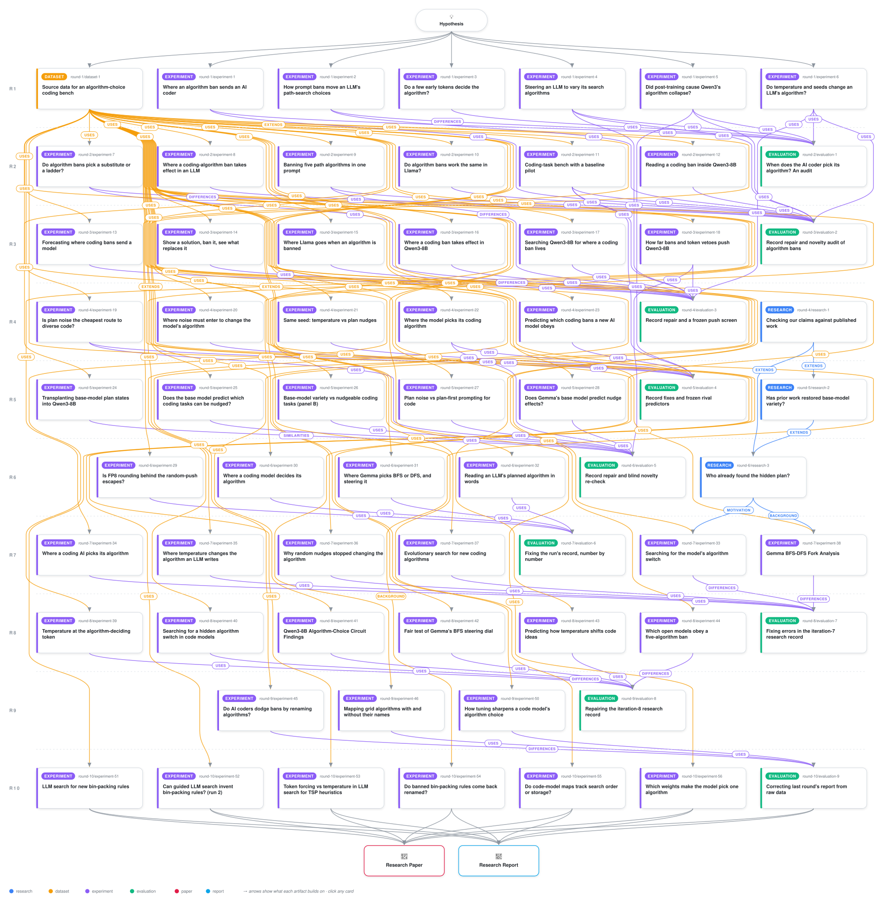

# A Random Activation Push Changes a Code Model's Algorithm Where Temperature Does Not

<div align="center">

<a href="https://cdn.jsdelivr.net/gh/ai-inventor-papers/ai-invention-295f8e-prompt-bans-substitute-not-just-subtract@fork/run_jSassd-YWLVC/workflow.svg">
<picture>
  <source media="(prefers-color-scheme: dark)" srcset="workflow-dark.svg">
  
</picture>
</a>

<sub>🖱️ <b><a href="https://cdn.jsdelivr.net/gh/ai-inventor-papers/ai-invention-295f8e-prompt-bans-substitute-not-just-subtract@fork/run_jSassd-YWLVC/workflow.svg">Open the interactive diagram</a></b> — every card links to its artifact folder.</sub>

</div>

> **TL;DR** — On the same random streams, a random push of Qwen3-8B's residual-stream states at the prompt's task-specification tokens changed which algorithm the model implemented in more seeds than sampling temperature did, by a paired difference of 0.545 per seed (95% CI 0.41 to 0.67) pooled over shortest path and k-th smallest (40 seeds). This preregistered contrast held in a single experiment graded partial overall; it ran only in an 8-bit (W8A8) engine and is untested in bfloat16. Temperature from 0.3 to 1.3 changed the algorithm in 0 of 20 seeds on each of three tasks while the number of phrasings grew, because one or two forking tokens settle the algorithm and the default leads there by 4.85 to 17.04 nats. Where that token is contested, a law built from its logits predicted the temperature response on five of six units, though a no-change baseline was nearly as accurate. No control applied to single samples produced a correct novel algorithm; one program search on online bin packing yielded eight programs that its manual read classed as a new idea, which an independent replication did not reproduce.

<details>
<summary>Full hypothesis</summary>

PRECEDENCE. This text is the hypothesis for iteration 10, the LAST iteration of the run. The older design fields carried over from drafts before iteration 1 (motivation, assumptions, investigation_approach, success_criteria, terms, alternates) describe the original ban design; where they conflict with this text, this text governs, and their literature remains background. Every claim of the iteration-9 text that is not restated below is carried as evidence with its engine tag (EVIDENCE) or closed (CLOSED BETS). The review of iteration 9 is BLOCKING: Step 0 (S0) answers each of its five MUST-FIX items and five minor items in place, and no item may be dropped.

IN PLAIN TERMS. Nine iterations established that a code model's 'idea' is a small, known repertoire. Asked for a path search program, Qwen3-8B writes BFS; temperature, seeds, top-k and thinking change the wording, not the algorithm. Where the model is undecided, one or two generated tokens decide the algorithm; temperature only reweights the alternatives those tokens already weigh; post-training sharpened exactly those tokens (and at Gemma's grid fork reversed the base model's preference); and no knob, internal edit, forced branch or prohibition has produced a correct novel algorithm in more than 20,000 audited correct programs. Iteration 9 answered the request's top-five question by mechanism as well as by geometry. Banned by five names, most open models re-implement BFS or DFS under other names (lexical minus mechanistic compliance 0.70 by the runtime label and 0.61 by the expansion-order tracer, positive in 10 of 10 configurations). The one model that obeys, Qwen3-32B with thinking, moves mostly to OTHER KNOWN disciplines (grid Bellman-Ford rounds, heaps keyed by a goal-independent coordinate, random frontiers); of the 76 hand-read survivors of the full ban (Qwen3-32B and Qwen3-14B), 0.30 are unit-weight Dijkstra, which is BFS order under another name. On maps built from language, unit-weight Dijkstra sits opposite the banned five; on the map built from name-scrubbed programs it sits at the edge while the Bellman-Ford survivors sit opposite, but that map follows code surface as strongly as behaviour. What the run has never done is the one thing the field's discovery systems do: let an executable evaluator select among the model's samples. The two planned artifacts that would have done it, on bin packing and on TSP, were lost to stalled sessions in iteration 9, after the bin-packing harness had passed its gate. Iteration 10 therefore makes the request's layman question its main object: with an evaluator on a task where novelty is measurable (online bin packing; constructive TSP as a replication fixed in advance), does the same 8B open model write heuristics that beat the textbook rule and decide unlike every published heuristic, and does spending the sampling randomness at the decision token buy more distinct ideas per call than temperature, as the fork account predicts? Beside it, the iteration tests renaming under prohibition on that task with an exact, name-blind behavioural instrument; settles whether the program map's edge is an edge in mechanism or in surface; locates post-training's sharpening in specific weights; and repairs the record as the review requires.

WHAT ITERATION 9 SETTLED. Engine tags: rename sampling through OpenRouter (quantised providers) and local vLLM; Qwen3-32B states from 4-bit NF4 weights; Qwen3-8B, Gemma and Llama states in bf16. Counts are correct programs unless marked attempts. Numbers below already carry the corrections the iteration-9 review demands.

(i) Names against mechanisms [art_8nXdw3_lDAll; DESCRIPTIVE, because the expansion-order tracer failed its gold gate, 182/260 = 0.70 against 0.90, failing on LLM-written IDDFS 0/34, IDA* 1/22 and jump point search 1/7].
- Rename gap over 546 retraced five-name-ban programs of ten configurations: 0.70 (0.57 to 0.82) by the runtime label (heap priorities, frontier evidence, restarts), 0.61 (0.45 to 0.76) by the tracer, 0.66 when unit-weight Dijkstra, IDA* and jump point search labels count as compliant; positive in 10/10 configurations under both instruments; within-program swap placebo -0.002. 294 of 371 covert programs carry BFS or DFS labels. Reasoning names a banned algorithm in 20/20, 32/35 and 47/47 covert programs of the three reasoning configurations. The obeying configuration (Qwen3-32B thinking) is instrument-dependent: gap 0.63 runtime, 0.31 tracer, bounds 0.30 to 0.70.
- Exhaustion curve (cumulative bans k = 1 to 5, 50 samples per k). At k = 1 both models comply by name and by mechanism (1.00: ban BFS gives DFS). Qwen3-14B: mechanistic compliance at k = 5 is 0.10 (runtime), 0.12 (hand reads), 0.24 (tracer) against lexical 0.86, so renaming holds under all three readings. Qwen3-32B: 0.22 (runtime) but 0.59 with hand reads substituted and 0.67 by the tracer, against lexical 0.89: a k = 5 gap of 0.22 to 0.30, below the committed 0.4; held-out templates 0.38, 0.54, 0.52 (gaps 0.56, 0.40, 0.42); the tracer curve is non-monotone (0.47 at k = 4, 0.67 at k = 5). Two coding artifacts inflated the runtime curve: the runtime label reads grid Bellman-Ford rounds as iterative deepening, and the coarse class map counted greedy best-first programs as violations at k = 4, where greedy was not yet banned (11 of 35 violations; the registered fine-class sensitivity was a no-op in the executed code); corrected k = 4 compliance is 0.48 (tracer 0.47) against 0.24.
- Survivors of Qwen3-32B (91 correct name-level survivors): runtime 0.79, tracer 0.43 in a banned order class. Hand reads of all 76 k = 5 survivors of both models: 0.30 in a banned class, every one unit-weight Dijkstra; the rest are known disciplines (coordinate-key heaps 18, grid Bellman-Ford 17, random-priority frontiers 8, raster flood-fill sweeps 3, set frontiers 3, random choice 2, mixed deque 2). The judges' names are least reliable exactly there (coordinate-key heaps called greedy best-first 45 times).
- Described ban (five mechanisms in words, no names; Qwen3-32B): instrument-dependent, from -0.07 (tracer: 0.60 against 0.67) to +0.58 (runtime: 0.80 against 0.22), about +0.21 under the per-cell reading the record favours (runtime label for the described cell, hand reads for the named cell).
- Rotated five-name sets: disconfirmed (joint sign 3/7, p 0.24); the planned name distance is degenerate on this catalogue (1 in 72 of 100 cells).
- gpt-oss-120b (exploratory): lexical 0.80, mechanistic 0.22 (runtime), mechanism-level survivors 0.06.
- 0 novel among 568 correct programs (73 candidates read by two judges and by hand).

(ii) The top-five landing with and without names [art_VVA3P0ocZNA2; committed verdict MIXED]. Unit-weight Dijkstra is opposite on the named (g/median 1.63), name-only (1.20) and described (1.08) manifolds of Qwen3-32B and at the edge on the program manifold (0.67; robust to readout block, to programs from Qwen3-32B only, and in Qwen3-8B, 0.63). The described manifold still evokes the names (a probe trained on named prompts labels it at balanced accuracy 0.69, chance 0.11; it labels programs at 0.17, which is chance for six classes, 0.167). Placement of the iteration-8 survivors (beyond unit-weight Dijkstra, post hoc): unit-weight Dijkstra 15/15 edge; the 15 Bellman-Ford/SPFA survivors 15/15 OPPOSITE on both Qwen3-32B frames (median g 28.1 against the frame median 24.8; 14/15 nearest the unit-weight Dijkstra programs), 10 edge and 5 opposite on the Qwen3-8B frame; the 3 BFS variants and 5 other known programs edge. Caveat: the program frame has only two non-banned classes above its floor (unit-weight Dijkstra, IDA*), so 'opposite' there means farther than their median. Representational similarity: the best fit of the named manifold is the textbook data-structure matrix (0.65, exact p 0.001; lexical 0.46); measured expansion order alone fits no language manifold (-0.03 to 0.16); the program manifolds fit behaviour (0.64 Qwen3-32B, 0.88 Qwen3-8B) but surface and length as strongly, and behaviour given surface is only 0.11 (Qwen3-32B primary frame), 0.32 (own-program frame) and 0.47 (Qwen3-8B). Reading: language maps encode names and textbook data-structure attributes, not measured expansion order; the program map's split mirrors expansion order (BFS-order survivors at the edge, relaxation survivors opposite) but is not yet separated from surface: on that map unit-weight Dijkstra's nearest banned class is greedy best-first, another heap program, not BFS. The geometry is correlational (iteration 7's in-manifold pushes moved 0/300).

(iii) Sharpening at the fork [art_cDba8_DycUJd; bf16]. Gemma grid fork: instruct P(default class) 0.671 against base 0.089; the base puts 0.25 on the alternative class and 0.66 of its fork mass on unmapped tokens, so post-training reversed and concentrated the choice (gain 1.78 nats [1.59, 2.00]; argmax differs on 20/20 prompts). The first-and-last-position forks sharpen the base model's own first choice (3.07 and 1.68 nats). Phrasing positions barely move (the instruct token is the base top-1 at 91% to 97% of them). Fork divergence is only 0.75 to 1.18 times that at base-entropy-matched positions: fork and high base entropy coincide (the Cantarero et al. confound). Llama is descriptive (its base model's chat-token embeddings are untrained). Patching Qwen3-8B-Base outputs into Qwen3-8B at the fork: the ten validated fork-stack nodes close 1.00 of the minimum spanning tree gap but matched random late-layer sets 0.81 (p 0.45; the random sets repeat components, effective size 8 to 9 of 10); on connected components 0.45 [0.28, 0.57] against random -0.22 (p 0.020), with a per-prompt mean share of only 0.13; task-specification nodes about 0; the instruct unembedding reading the base residual carries 0.43 (minimum spanning tree) and 0.85 (connected components) of the gap, and the unembedding rows of ' dfs' and ' bfs' moved more than 91% and 96% of all rows. Generation: a one-token fork-stack patch gives 19/30 correct Prim, exactly as a matched random set; Fork-Patched Decoding (base logits at the fork) gives 18/30 DFS on connected components against 1/30, at pass 29 to 30 of 30. The repaired held-out arm of the layer-0 condition MLP averages 3.86 nats but is bimodal (forced rows about 7.9, clean rows about 0).

(iv) Record [art_iYh9zVP7myjJ]: 49 corrections; the alias test on iteration 8's named manifold reads CONFOUNDED (alias-level Spearman -0.61, exact p 0.009; within algorithms -0.12, p 0.46: not detected, three algorithms, underpowered).

(v) Lost, not refuted: the weighted-shortest-path ban, the bin-packing search and the TSP replication were lost at the execution step (API errors and a stalled session). Before the loss the bin-packing harness was built and PASSED its gate: FunSearch semantics reproduced; best fit excess 5.37% on OR3 and 3.98% on Weibull 5k; FunSearch's published heuristics 3.11% on OR3 and 0.68% on Weibull 5k; priority-form first, best and worst fit equal the hand-coded packers; a known corpus fetched at pinned commits (FunSearch notebook, EoH runs 1 to 3, ReEvo, HSEvo, LLM4AD, MCTS-AHD, arXiv 2510.27353). Run-relative location: 3_invention_loop/iter_9/gen_art/gen_art_experiment_48 (src/bp.py, src/sandbox.py, src/gate.py, data/instances/, ext/, results/harness_gate.json). The TSP task module and instance sets are in 3_invention_loop/iter_9/gen_art/gen_art_experiment_49 (src/tsp_task.py).

(vi) Carried from iterations 1 to 8 (engine tags as recorded): collapse and temperature nulls (BFS 797/800; same seed 0/20; literal thinking-on top-k 10 cell 0/20); the fork decides (at most 0.004 bits given its classes on five Qwen3-8B and Gemma units); the composed temperature law (5 of 6 units); fork-dosed temperature (valid anagram Hill-1 1.78 to 2.78; collapsed connected components fails); no certified low-rank variable under DAS in two families; a late fork-position stack carries the fork logit, different motif from Gemma; the Gemma dial ties prompting; single bans land on one substitute (DFS for BFS 86/100, Bellman-Ford/SPFA for Dijkstra 83/100); evolutionary search on catalogue tasks reached only known techniques (kth smallest 78/2,500, 12 clusters, 66/93 level-b rows at depth 2 or more; 0 novel); 0 novel in every audit.

THE REPERTOIRE ACCOUNT (the hypothesis of iteration 10).
- R1 location, R2 origin, R3 sampling: unchanged. The fork decides; its odds are written from task-specification states through a late stack of fork-position components with no certified variable; temperature acts on the idea only through the fork, in proportions its logits fix.
- R4 sharpening: in two families post-training concentrated the fork (Qwen3-8B: the default is often the base model's second or third choice; Gemma's grid fork: the base preference reversed), at forks that are high-entropy positions of the base; in Qwen3-8B the change sits at the fork, in late MLPs and in the unembedding, not upstream.
- R5 repertoire bound: no single-sample knob, internal edit, forced branch or prohibition produces a correct novel algorithm.
- R6 prohibition (revised on the corrected evidence): a ban that leaves a known alternative changes the mechanism; a ban that names the whole repertoire is answered by renaming in most configurations (BFS or DFS under other names); where reasoning lets the model obey (Qwen3-32B), it moves to other KNOWN disciplines, not new ones. Maps built from language place survivors by name and textbook attributes (opposite); the program map places them by what the code does and how it looks (BFS-order survivors at the edge, relaxation survivors opposite).
- R7 discovery (THE MAIN CLAIM): because the repertoire is bounded and decoding spends its randomness on phrasing, a correct new idea needs an external evaluator that keeps rare improvements and composes them across generations; and exploration buys more distinct ideas per call when it is spent at the decision token (branching there) than on every token (temperature) or requested in words (an instruction to differ, which R6 predicts is often obeyed in text but not in behaviour).

WHY WE EXPECT R7 (mechanisms, not hopes).
- Selection, not generation, is the bottleneck: the inspiration repository reached 10 algorithms only with external selection (gen_then_select); in iteration 7 an evaluator-driven search reached known techniques outside the catalogue at 7.8 times the per-call rate of the instruction alone, composing them across generations (66 of 93 such programs at depth 2 or more); FunSearch, EoH and ReEvo report priority functions that beat best fit once an evaluator selects.
- On a scored open-ended task there is no ceiling of known techniques: a composed priority function with new terms is new behaviour by construction, and bin choices on probe states measure behaviour exactly, with no tracer gate to fail.
- Fork mechanics: at a decision token the lower-ranked tokens lead to other ideas (forcing each of the fork's top 64 tokens reached one more known idea on three units), while 90% of positions have entropy below 0.0003 to 0.05 nats (Table 422); global temperature therefore spends nearly all its randomness off the decision, and raising it to 1.3 or 1.6 bought no correct algorithmic diversity on collapsed tasks (correct-only Hill-1 at most 1.09) while phrasings multiplied.
- R6 in words: 'use a different idea from both parents' is a request at the level of names; the rename gap predicts many offspring that claim a new idea but decide like a parent.

WHAT EACH OUTCOME WOULD MEAN.
- V1 and V3 hold: the run's first correct novel solutions, and the answer to the layman question: an evaluator, not a knob, makes an 8B open model creative in the measurable sense. With V2, a cheap operator grounded in the fork finding (spend the randomness where the idea is decided).
- V1 holds, V3 fails: search improves the score but stays inside the published heuristic space; the repertoire bound extends to evaluator search at this budget.
- V2 ties: where randomness is spent does not matter once an evaluator selects; selection is the whole bottleneck.
- No arm beats best fit: the bound holds even with an evaluator at 8,000 calls per arm with an 8B mutator, a direct negative stated with its budget.

CLAIMS OF ITERATION 10. Primary family (Holm, alpha 0.05): V1, V2, V3 (online bin packing). Secondary family (Holm): V4 (TSP replication), V6 (rename rate of idea offspring), P1 to P3 (prohibition with an exact instrument), G1 and G2 (geometry), W1 and W2 (weights), S0. V5 and W3 are descriptive.

V. DISCOVERY WITH AN EVALUATOR (main; the request's 'truly novel solutions'; artifacts NOV-B1, NOV-B2, NOV-T).
- Harness: copy the iteration-9 harness, sha256-verify every file and instance set, and rerun its gate before any search call; a mismatch stops the artifact. Selection instances SEL-OR and SEL-W only; the held-out sets (H-W5k, H-W10k, H-SHIFT, H-OR1 to H-OR4) are never touched by selection; score = excess bins over the L1 bound. A program is valid when it runs within the time limit on every instance and returns one score per valid bin.
- Known corpus: the textbook rules (first, best, worst, next and almost-worst fit; harmonic) plus every published discovered heuristic in the harness's ext/ folder plus any found by the artifact's dated search, each run through the same harness.
- Behaviour instrument (exact, name-blind): bin choices on 2,000 committed probe states (packing traces of the references on selection-distribution items plus uniform states); agreement = share of identical choices; behaviour clusters = complete-linkage clusters at within-cluster agreement of at least 0.95.
- Mutator: Qwen3-8B, thinking off, vLLM (sampling only, any precision); FunSearch prompt with two parents sorted by score; island search (for example five islands with periodic reset of the worse half); seed program best fit; sandboxed evaluation with a time limit; invalid or timed-out programs score as failures.
- Arms at matched calls (2,000 calls per arm per seed; generated tokens reported): T1.0 (top-p 1); T1.6 with top-p 0.95; DTB, decision-token branching (sample at T 1.0 recording top-20 log probabilities over the first 48 generated body tokens; at the highest-entropy position force a token drawn uniformly from ranks 2 to 8; continue at T 1.0); RPB, the same forcing at a uniformly random position among the first 48 (placebo); IDEA, T 1.0 with the instruction to use an idea different from both parents. NOV-B1 runs seeds 0 and 1, NOV-B2 seeds 2 and 3 under the same frozen protocol; each commits its predictions by sha256 before its first search call and is self-contained.
- V1: the best program of every core arm (T1.0, T1.6, DTB, RPB), chosen on selection instances only, beats best fit on held-out Weibull 5k and on H-OR3 (excess at most 0.8 of best fit's, that is at most 3.18% and 4.30%) in both NOV-B artifacts. Disconfirming: no arm beats best fit.
- V2: DTB yields at least 1.5 times the behaviour clusters of valid programs per 1,000 calls of T1.0 and of T1.6 in each seed set (paired by seed), with a held-out best score at least as good as either, and at least 1.2 times RPB (so the gain belongs to the decision token, not to forcing as such). Disconfirming: at most 1.0 times either temperature arm.
- V3: at least one program, selected without held-out data, that beats best fit on held-out instances (the 0.8 rule) and agrees on fewer than 0.9 of probe decisions with EVERY heuristic of the known corpus, judged not known by two gated judge families (10 controls each, at least 9 of 10) and a manual read; the number of such novel-and-better clusters is reported per arm. Disconfirming: none.
- V4 (artifact NOV-T, fixed in advance so the contrast is not chosen after bin packing): a constructive next-city heuristic in the ReEvo/EoH interface; selection on random uniform n 50 and 100; held out n 200 and TSPLIB instances with reference tours from a strong solver; known corpus nearest neighbour plus the published constructive heuristics; the same arms; V1 against nearest neighbour (gap to the reference at most 0.8 of nearest neighbour's) and V2 in the same direction. The operator claim stands only if V2 holds on both tasks.
- V5 (descriptive; where new heuristics are born inside the model): for every offspring that founds a new behaviour cluster with a better score, teacher-force it under its own prompt, list the positions where it took a non-argmax, high-entropy token, force the argmax at the first one to three of them and resample (20 continuations each); report the share of new clusters that revert to a parent's cluster, against non-argmax positions drawn at random. R1 predicts that new ideas are born at a few decision tokens.
- V6 (secondary): the rename rate, the share of valid IDEA offspring whose probe decisions agree at least 0.95 with one of their parents, is at least 0.4 and at most 0.1 below that of T1.0 offspring: instruction-level novelty is obeyed in text, not in behaviour. Disconfirming: below 0.2.

P. PROHIBITION WITH AN EXACT INSTRUMENT (secondary; artifact NOV-R; the request's prohibition and prompt-instruction parts on a second task).
- One-shot prompting for an online bin-packing priority function (no parents, no evaluator) under: a baseline (N 50) that defines each model's own frequency order over the textbook rules; cumulative name bans of the model's top k = 1 to 5 rules (N 50 per k; alias table committed: names and abbreviations only); a described ban of the same five rules at k = 5 (each description named correctly by the model in at least 16 of 20 separate queries, else two rewrites, else excluded); held-out templates at k = 5. Models: Qwen3-8B thinking off (local), Qwen3-14B and Qwen3-32B thinking on (OpenRouter, providers pinned).
- Instrument: V's probe-decision agreement, gated before any ban row (references 1.0; planted renamed copies 1.0; planted tie-break variants at least 0.95; planted different rules below 0.95). Mechanistic compliance: agreement below 0.95 with every banned rule. Lexical compliance: no banned alias in code or comments. Quality: valid and within 1.1 of best fit's excess on selection instances.
- P1: at k = 1 both rates at least 0.7 among valid programs; mechanistic compliance falls with k (Jonckheere-Terpstra p below 0.05) while lexical stays at least 0.7; the k = 5 gap is at least 0.3 in at least two of three models. Disconfirming: the rates within 0.1 at every k in every model.
- P2: the described ban raises mechanistic compliance at k = 5 by at least 0.2 over the named ban (Newcombe interval excluding 0) in at least two models; this settles, with an instrument that cannot misread, the grid result that was instrument-dependent.
- P3 (the bound without an evaluator): the share of samples that beat best fit on held-out instances (0.8 rule) and are behaviourally novel (V3's 0.9 rule) is at most 0.02 per cell; read against the search arms of V (descriptive across artifacts).

G. THE TOP-FIVE LANDING, MECHANISM AGAINST SURFACE (secondary; artifact TP-G2; Qwen3-8B in bf16 first, Qwen3-32B NF4 second, with iteration 9's frozen readouts, blocks and k; iteration 9's states and geodesic graphs are kept on the run volume).
- Factorial program set on the grid task: expansion discipline (BFS order, DFS order, goal-heuristic order, path-cost order, raster relaxation rounds, random order) crossed with container (deque or list FIFO, list stack or recursion, heap with tuple keys, two-dimensional arrays, set) wherever the pair is implementable (for example BFS order through a heap keyed by depth, which is unit-weight Dijkstra; DFS order through a heap keyed by negative depth; heuristic order through a sorted list), at least 10 verified, name-scrubbed programs per cell from forced Qwen3-32B generations that specify discipline and container, checked by the iteration-9 tracer and hand reads on the disciplines they read reliably, and by both hidden suites. Bidirectional BFS, IDDFS, jump point search and bidirectional A* are topped up to at least 10 programs each, so that landings are classed over at least four non-banned algorithms.
- G1: partial Spearman of the program-state RDM with the discipline matrix controlling container, and with the container matrix controlling discipline. Prediction: discipline partial at least 0.3 and above the container partial on at least one model (bootstrap over programs). Disconfirming: discipline partial at most 0.1 on both models, in which case the program map's edge is an edge in surface.
- G2: preregistered placement of every survivor family (unit-weight Dijkstra, grid Bellman-Ford/SPFA, coordinate-key heaps, random frontiers, raster sweeps, set frontiers) and of the covert BFS and DFS programs of the non-obeying configurations, on the full frame and on discipline-matched and container-matched subframes. Prediction: unit-weight Dijkstra survivors land with BFS-order programs in any container (edge), Bellman-Ford survivors with relaxation programs (opposite), covert BFS and DFS inside the banned clusters in at least 0.8. Every figure in actual activation coordinates (PCA, Isomap, MDS with stress; centroids sized and coloured by implemented count under the baseline and under the ban).

W. WHERE POST-TRAINING WROTE THE DEFAULT (secondary; artifact BASE-W; Qwen3-8B against Qwen3-8B-Base on connected components, minimum spanning tree, grid and shortest path; gemma-3-4b-pt against -it on the grid fork; bf16; fork positions, openings and token maps of art_lzuosbrb34wB and art_cDba8_DycUJd).
- W1: at the fork only, replacing the instruct unembedding rows of the fork-class tokens by the base rows closes at least 0.5 of the instruct-minus-base margin gap on connected components (teacher forced, 20 prompts), against at most 0.15 for the same rows moved by a random direction of matched norm (50 draws); in generation (30 slots of common random numbers, hidden tests) at least 10 of 30 correct DFS against at most 3 of 30 for the random-direction rows, with Fork-Patched Decoding (18 of 30 in iteration 9) as the published baseline. Disconfirming: the rows close at most 0.2.
- W2: base weights of the late MLPs (layers 26 to 35), singly and jointly, against Frobenius-matched swaps of early-layer MLPs, on minimum spanning tree and connected components; with W1 this gives a weight-level decomposition of the gap.
- W3 (descriptive): the same row test at Gemma's reversed grid fork (tied embeddings: the swap is applied at the output only).

S0. STEP 0 (CPU; record repair marked 'iteration-10 correction'; answers every item of the iteration-9 review).
- (0a) Table 431: a 'mechanistic, hand reads substituted' column with its gap and Newcombe interval for every k = 5 cell; the claim restated per model (supported for Qwen3-14B under all three readings; for Qwen3-32B only the runtime label meets the bars, with a k = 5 gap of 0.22 to 0.30 by tracer and hand reads and a non-monotone tracer curve, 0.47 at k = 4 and 0.67 at k = 5); the Section 9.3 sentence 'because it reads the coordinate-key heaps and Bellman-Ford rounds ... as compliant' replaced by the hand-read adjudication; Section 9.8 'Established', the Table 444 verdict and the closing sentences ('falls ... to 0.22 (Qwen3-32B)', 'banning the repertoire moves compliance to the names', 'mostly not renamed BFS') revised to match.
- (0b) The fine-class sensitivity implemented for the runtime label (greedy best-first, A*, jump point search and IDA* in their own classes; only the names banned at each k count), reported beside Table 431 for both models; the k = 3 to k = 4 step restated with it (Qwen3-32B k = 4: 22/46 = 0.48, tracer 0.47, against 0.24); Section 9.3 states that the registered sensitivity was a no-op in the executed code (mech_ok in src/analysis_v9.py applies fine classes only when MECH_FIELD == 'order_class', so results/n3.json repeats the primary).
- (0c) Table 433 gains the tracer row (described 0.60, 29 of 48, against named 0.67, 31 of 46: -0.07, -0.25 to 0.12) and a named comparator with hand reads substituted (0.59; difference about +0.21); the finding is restated as instrument-dependent (-0.07 to +0.58; about +0.2 under the per-cell reading the record argues for) in Sections 9.3 and 9.8 and in the closing.
- (0d) Table 438 gains per-family placement rows for every frame (Bellman-Ford/SPFA 15/15 opposite on both Qwen3-32B frames, median g 28.1 against 24.8, 14/15 nearest unit-weight Dijkstra; 10 edge and 5 opposite on Qwen3-8B; the 3 BFS variants and 5 other known programs edge), with two caveats: not preregistered, and the frame has only two non-banned classes. Section 9.9 and the closing say that the unit-weight Dijkstra survivors place at the edge and the Bellman-Ford/SPFA survivors opposite on both Qwen3-32B frames.
- (0e) Table 437 gains R_DS, R_beh_order and R_desc_lex; the correlation between the lexical and data-structure matrices and a partial RSA of each controlling for the other are reported; Section 9.4 and the closing read 'track lexical distance and textbook data-structure attributes, not measured expansion order'.
- (0f) The held-out rerun of the layer-0 condition MLP is reported per side and per contrast (n = 5), with how the 8.14 and 7.41 pair values were averaged, the sign-flip test on the five contrasts, 'half its pair values' rephrased, and the 153 of 765 empty edits of contrasts F11 and F15 stated.
- (0g) Random patching sets: effective set sizes (an MLP repeats in 47/50, 36/50 and 50/50 sets), nulls restricted to ten-component sets, the Rscaled null (median 0.64, p 0.098 on minimum spanning tree) beside Rpure, and the per-prompt share distribution on connected components (mean 0.13 against the ratio of means 0.45; five fork MLPs 0.41 against 0.07).
- (0h) The sensitivity that counts unit-weight Dijkstra (and IDA*, jump point search) as compliant is added to the rename-gap and exhaustion tables (pooled 0.662); C6's instrument range (runtime 0.63, tracer 0.31, bounds 0.30 to 0.70) is stated wherever the obeying model's gap is quoted; 'read by runtime expansion order' becomes 'read by the runtime label (heap priorities, frontier evidence, restarts) and by the expansion-order tracer'.
- (0i) Slips: the six-class chance 0.167 beside the probe's 0.17; '7 of 350' rotated and described rows lost; Table 440 gains the base P(alternative) 0.25 and the unmapped base mass 0.663, and Gemma's grid fork is described as reversed and concentrated; 'within algorithms the relation vanishes' becomes 'not detected (three algorithms; underpowered)'.
- (0j) Sections 9.6 and 9.9 note that the bin-packing harness was built and passed its gate before the failure and is reused by iteration 10's evaluator search; no search ran.
- Inputs: the current report; art_8nXdw3_lDAll data/samples_v9.jsonl, data/manual_reads_v9.jsonl, results/n3.json, n3_tracer.json, n3d.json, n3d_tracer.json, instrument_bounds.json, retrace.jsonl and src/analysis_v9.py; art_VVA3P0ocZNA2 results/placement.json and rsa.json; art_cDba8_DycUJd results/b3_summary.json, b3_heldout_rows.jsonl, random_sets.json and src/cmap9.py; results/harness_gate.json of the lost bin-packing workspace.

DESIGN FOR ITERATION 10. Seven artifacts; each is self-contained, because artifacts of one iteration run in parallel and cannot read each other's outputs.
1. NOV-B1 (one GPU of at least 24 GB, about 4 hours): V1 to V3, V5, V6 on seeds 0 and 1.
2. NOV-B2 (the same frozen protocol on seeds 2 and 3; an optional arm that draws DTB's forced token from Qwen3-8B-Base's distribution at the same position, which R4 predicts beats rank-2-to-8 forcing, run only if memory allows).
3. NOV-T (one GPU, about 4 hours): V4.
4. NOV-R (about USD 4 of OpenRouter plus a local Qwen3-8B; CPU scoring): P1 to P3.
5. TP-G2 (one GPU of 24 to 32 GB): G1 and G2.
6. BASE-W (one GPU of at least 24 GB, about 2 hours): W1 to W3.
7. S0 (CPU): as above.
Infrastructure, because iteration 9 lost three artifacts to stalled sessions: each artifact copies and verifies its inputs first, hash-commits its predictions before any long run, checkpoints every stage to disk and writes partial results as it goes, scales in stages of 10, 100 and full size with a time-per-call extrapolation, runs long jobs in the background with polling, and never holds one model request open for more than a few minutes.

INSTRUMENTS. vLLM or OpenRouter only for plain sampling; bf16 for every internal claim; Qwen3-32B states from NF4 (precision check carried: geodesic Spearman 0.916 against bf16 on Qwen3-8B). Primary outcomes over all samples, with invalid and timed-out programs counted as failures; Wilson and Newcombe intervals; every artifact commits its predictions by sha256 before its first decisive sample.

PRE-REGISTRATION TABLE (claim | measurement | threshold | disconfirming).
- V1 (primary) | held-out excess of each arm's best program against best fit, both NOV-B artifacts | at most 0.8 of best fit's on Weibull 5k and OR3 | no arm beats best fit.
- V2 (primary) | behaviour clusters of valid programs per 1,000 calls; held-out best; RPB | DTB at least 1.5 times T1.0 and T1.6 in each seed set, best at least as good, at least 1.2 times RPB | at most 1.0 times.
- V3 (primary) | probe agreement with every known heuristic; held-out score; two gated judges and a manual read | at least one program below 0.9 that beats best fit, judged not known | none.
- V4 (secondary) | V1 and V2 on constructive TSP | gap at most 0.8 of nearest neighbour's; V2 in the same direction | V2 reversed.
- V5 (descriptive) | reversion of new clusters when birth tokens are forced back to the argmax | reported | none.
- V6 (secondary) | rename rate of IDEA offspring | at least 0.4 | below 0.2.
- P1 (secondary) | lexical and mechanistic compliance by k, three models | k = 1 both at least 0.7; mechanistic falls (p below 0.05); k = 5 gap at least 0.3 in two models | within 0.1 at every k.
- P2 (secondary) | described minus named mechanistic compliance at k = 5 | at least 0.2 in two models | at most 0.
- P3 (secondary) | novel-and-better share without an evaluator | at most 0.02 per cell | reported.
- G1 (secondary) | partial RSA, discipline against container | discipline partial at least 0.3 and above container on one model | at most 0.1 on both.
- G2 (secondary) | landing class per survivor family over at least four non-banned classes | unit-weight Dijkstra edge, Bellman-Ford opposite; covert BFS and DFS inside in at least 0.8 | unit-weight Dijkstra opposite on the discipline-matched frame.
- W1 (secondary) | gap closed by the base fork-token unembedding rows; generation | at least 0.5 against at most 0.15; at least 10/30 DFS against at most 3/30 | at most 0.2.
- W2 (secondary), W3 and S0 | weight decomposition; Gemma rows; every review item | reported; every item answered | none.

SCREEN AND CONFIRMATION. In V, selection instances are the screen and the held-out sets confirm; the operator contrast is fixed in advance and must hold in two independent seed sets (NOV-B1, NOV-B2) and in the same direction on TSP; every candidate novel program is re-evaluated on held-out sets it never saw and judged blind to its arm. In P, the held-out templates confirm at k = 5. In G, the frame, blocks, k and verdict rule are committed before any survivor is placed. A failed confirmation kills the claim: no subgroup search and no re-screen on confirmation data.

MINIMUM PUBLISHABLE RESULT. S0 in full; one NOV-B artifact with T1.0, T1.6, DTB and RPB at two seeds, scored for V1 to V3 against the full known corpus; NOV-R on Qwen3-8B and one reasoning model; G1 on Qwen3-8B; W1 teacher forced on connected components.

DROP ORDER if the budget binds: 1. NOV-B2's base-fork arm; 2. V5; 3. Qwen3-14B in NOV-R; 4. Qwen3-32B states in TP-G2; 5. W3; 6. the IDEA arm (and with it V6); 7. NOV-T's TSPLIB set; 8. the second seed of each NOV-B artifact.

NEVER DROPPED: S0; the harness gate; T1.0, T1.6, DTB and RPB at two seeds in at least one NOV-B artifact; V1 to V3 scored against the full known corpus; NOV-R on one model; G1 on one model; W1 teacher forced.

THE FINAL RECORD. Iteration 10 is the last, so every part of the request ends with an answer: the done parts as established; the top-five question as answered by mechanism and by kind of map; the 'truly novel' question by V (positive, bounded or negative, with its budget stated); every claim that stayed null is declared null.

CLOSED BETS (one sentence each in the paper; no further budget).
- Newly closed: the expansion-order tracer as a gate-passing instrument for LLM-written IDDFS, IDA* and jump point search (two revision rounds, 0.70); rotated five-name sets as a name-against-mechanism separator (degenerate name distance; 3 of 7); the described manifold as a name-free map (it evokes names, 0.69); fork-stack specificity for the sharpening on minimum spanning tree (random late sets close 0.81); fork-stack patching as the carrier in generation (19/30 equals random); Llama base under the chat template (untrained special-token embeddings); 'the obeying model renames BFS' as its main response (hand reads 0.30, all unit-weight Dijkstra).
- Carried: every closed bet of iterations 1 to 9 (among them DAS variable search at the fork; fork-dosed temperature on collapsed tasks; the low-entropy fork; transcoder attribution graphs; fitted subspaces as the channel of random pushes; saturating-dose steering; the cross-family motif match; the Gemma dial as better than prompting; temperature above 1 as an idea source; the in-manifold top-five push; activation rounding; the NLA as a pre-code readout; Gemma Scope 2 features over difference in means; verbalized sampling; signature vetoes; the long-form novelty instruction).

POSITIONING (checked by a dated search inside each artifact). V: FunSearch (Nature 2024), EoH (ICML 2024), ReEvo (NeurIPS 2024), AlphaEvolve (2025) and the HSEvo, MCTS-AHD and LLM4AD heuristics already in the harness's corpus; DivAlgo; Beneath the Diff (EMNLP 2026); Forking Paths (ICLR 2025); Beyond the 80/20 Rule (NeurIPS 2025) and entropy-triggered branching in reinforcement-learning rollouts; Fork-Patched Decoding (Cantarero et al.); Embarrassingly Simple Self-Distillation (arXiv 2604.01193). Added: exploration spent at decision tokens as a mutation operator, priced against temperature and instruction mutation at matched calls, with behavioural novelty measured against the published heuristics and the rename rate of instruction-level novelty. P: denial prompting (NAACL 2025), compact constraint encoding (Tang 2026), IFEvalCode. G: Manifold Steering (ICML 2026 workshop spotlight). W: Cantarero et al.; Sparse but Critical (ICLR 2026); Selective Layer Restoration (arXiv 2602.06665); cross-model activation patching (Prakash et al., ICLR 2024). Permitted wording if V holds: 'with an executable evaluator, an 8B open instruct model whose unaided repertoire is bounded wrote online bin-packing heuristics that beat best fit on held-out instances and decide unlike every published heuristic we could retrieve (search dated in the artifact)'.

COVERAGE OF THE REQUEST. Truly novel solutions: V on two scored tasks. Prohibit the top five, edge or opposite side, in actual activation geometry with geodesics, MDS and centroids by implemented count: G (mechanism against surface), with P (renaming under prohibition on a second task). How creativity manifests inside: W (where post-training wrote the default) and V5 (where new heuristics are born). Is temperature the creativity knob: V2 in the discovery setting (temperature against decision-token branching at matched calls). Every other part (behaviour as in the repository, the BFS test, questions 1a to 1c, the same seed, top-k 10, context seeds, the two novelty instructions, the mean-answer hypothesis, thought anchors, NLA, SAEs, logit and Jacobian lenses, circuits, the circle check): done, carried as evidence.

</details>

[](https://ai-inventor-papers.github.io/ai-invention-295f8e-prompt-bans-substitute-not-just-subtract/fork/run_jSassd-YWLVC/) [](https://ai-inventor-papers.github.io/ai-invention-295f8e-prompt-bans-substitute-not-just-subtract/fork/run_jSassd-YWLVC/interactive.html)

[](https://cdn.jsdelivr.net/gh/ai-inventor-papers/ai-invention-295f8e-prompt-bans-substitute-not-just-subtract@fork/run_jSassd-YWLVC/paper.pdf) [](https://cdn.jsdelivr.net/gh/ai-inventor-papers/ai-invention-295f8e-prompt-bans-substitute-not-just-subtract@fork/run_jSassd-YWLVC/report.pdf) [](https://cdn.jsdelivr.net/gh/ai-inventor-papers/ai-invention-295f8e-prompt-bans-substitute-not-just-subtract@fork/run_jSassd-YWLVC/exec_summary.pdf) [](https://cdn.jsdelivr.net/gh/ai-inventor-papers/ai-invention-295f8e-prompt-bans-substitute-not-just-subtract@fork/run_jSassd-YWLVC/round-10/report.pdf) [](https://github.com/ai-inventor-papers/ai-invention-295f8e-prompt-bans-substitute-not-just-subtract/tree/fork/run_jSassd-YWLVC/paper_latex)

**Round reports:** [Round 1](https://cdn.jsdelivr.net/gh/ai-inventor-papers/ai-invention-295f8e-prompt-bans-substitute-not-just-subtract@fork/run_jSassd-YWLVC/round-1/report.pdf) · [Round 2](https://cdn.jsdelivr.net/gh/ai-inventor-papers/ai-invention-295f8e-prompt-bans-substitute-not-just-subtract@fork/run_jSassd-YWLVC/round-2/report.pdf) · [Round 3](https://cdn.jsdelivr.net/gh/ai-inventor-papers/ai-invention-295f8e-prompt-bans-substitute-not-just-subtract@fork/run_jSassd-YWLVC/round-3/report.pdf) · [Round 4](https://cdn.jsdelivr.net/gh/ai-inventor-papers/ai-invention-295f8e-prompt-bans-substitute-not-just-subtract@fork/run_jSassd-YWLVC/round-4/report.pdf) · [Round 5](https://cdn.jsdelivr.net/gh/ai-inventor-papers/ai-invention-295f8e-prompt-bans-substitute-not-just-subtract@fork/run_jSassd-YWLVC/round-5/report.pdf) · [Round 6](https://cdn.jsdelivr.net/gh/ai-inventor-papers/ai-invention-295f8e-prompt-bans-substitute-not-just-subtract@fork/run_jSassd-YWLVC/round-6/report.pdf) · [Round 7](https://cdn.jsdelivr.net/gh/ai-inventor-papers/ai-invention-295f8e-prompt-bans-substitute-not-just-subtract@fork/run_jSassd-YWLVC/round-7/report.pdf) · [Round 8](https://cdn.jsdelivr.net/gh/ai-inventor-papers/ai-invention-295f8e-prompt-bans-substitute-not-just-subtract@fork/run_jSassd-YWLVC/round-8/report.pdf) · [Round 9](https://cdn.jsdelivr.net/gh/ai-inventor-papers/ai-invention-295f8e-prompt-bans-substitute-not-just-subtract@fork/run_jSassd-YWLVC/round-9/report.pdf) · [Round 10](https://cdn.jsdelivr.net/gh/ai-inventor-papers/ai-invention-295f8e-prompt-bans-substitute-not-just-subtract@fork/run_jSassd-YWLVC/round-10/report.pdf)

This repository contains all **66 artifacts** produced across **10 rounds** of an autonomous AI research run — round by round, exactly in the order they were invented.

## Round 1

| Artifact | Type | Demo | Source | Builds on |
|----------|------|------|--------|-----------|
| **[Source data for an algorithm-choice coding bench](https://github.com/ai-inventor-papers/ai-invention-295f8e-prompt-bans-substitute-not-just-subtract/tree/fork/run_jSassd-YWLVC/round-1/dataset-1)** | [](https://github.com/ai-inventor-papers/ai-invention-295f8e-prompt-bans-substitute-not-just-subtract/tree/fork/run_jSassd-YWLVC/round-1/dataset-1) | [](https://colab.research.google.com/github/ai-inventor-papers/ai-invention-295f8e-prompt-bans-substitute-not-just-subtract/blob/fork/run_jSassd-YWLVC/round-1/dataset-1/demo/data_code_demo.ipynb) | [](https://github.com/ai-inventor-papers/ai-invention-295f8e-prompt-bans-substitute-not-just-subtract/tree/fork/run_jSassd-YWLVC/round-1/dataset-1/src) | — |
| **[Where an algorithm ban sends an AI coder](https://github.com/ai-inventor-papers/ai-invention-295f8e-prompt-bans-substitute-not-just-subtract/tree/fork/run_jSassd-YWLVC/round-1/experiment-1)** | [](https://github.com/ai-inventor-papers/ai-invention-295f8e-prompt-bans-substitute-not-just-subtract/tree/fork/run_jSassd-YWLVC/round-1/experiment-1) | [](https://colab.research.google.com/github/ai-inventor-papers/ai-invention-295f8e-prompt-bans-substitute-not-just-subtract/blob/fork/run_jSassd-YWLVC/round-1/experiment-1/demo/method_code_demo.ipynb) | [](https://github.com/ai-inventor-papers/ai-invention-295f8e-prompt-bans-substitute-not-just-subtract/tree/fork/run_jSassd-YWLVC/round-1/experiment-1/src) | — |
| **[How prompt bans move an LLM's path-search choices](https://github.com/ai-inventor-papers/ai-invention-295f8e-prompt-bans-substitute-not-just-subtract/tree/fork/run_jSassd-YWLVC/round-1/experiment-2)** | [](https://github.com/ai-inventor-papers/ai-invention-295f8e-prompt-bans-substitute-not-just-subtract/tree/fork/run_jSassd-YWLVC/round-1/experiment-2) | [](https://colab.research.google.com/github/ai-inventor-papers/ai-invention-295f8e-prompt-bans-substitute-not-just-subtract/blob/fork/run_jSassd-YWLVC/round-1/experiment-2/demo/method_code_demo.ipynb) | [](https://github.com/ai-inventor-papers/ai-invention-295f8e-prompt-bans-substitute-not-just-subtract/tree/fork/run_jSassd-YWLVC/round-1/experiment-2/src) | — |
| **[Do a few early tokens decide the algorithm?](https://github.com/ai-inventor-papers/ai-invention-295f8e-prompt-bans-substitute-not-just-subtract/tree/fork/run_jSassd-YWLVC/round-1/experiment-3)** | [](https://github.com/ai-inventor-papers/ai-invention-295f8e-prompt-bans-substitute-not-just-subtract/tree/fork/run_jSassd-YWLVC/round-1/experiment-3) | [](https://colab.research.google.com/github/ai-inventor-papers/ai-invention-295f8e-prompt-bans-substitute-not-just-subtract/blob/fork/run_jSassd-YWLVC/round-1/experiment-3/demo/method_code_demo.ipynb) | [](https://github.com/ai-inventor-papers/ai-invention-295f8e-prompt-bans-substitute-not-just-subtract/tree/fork/run_jSassd-YWLVC/round-1/experiment-3/src) | — |
| **[Steering an LLM to vary its search algorithms](https://github.com/ai-inventor-papers/ai-invention-295f8e-prompt-bans-substitute-not-just-subtract/tree/fork/run_jSassd-YWLVC/round-1/experiment-4)** | [](https://github.com/ai-inventor-papers/ai-invention-295f8e-prompt-bans-substitute-not-just-subtract/tree/fork/run_jSassd-YWLVC/round-1/experiment-4) | [](https://colab.research.google.com/github/ai-inventor-papers/ai-invention-295f8e-prompt-bans-substitute-not-just-subtract/blob/fork/run_jSassd-YWLVC/round-1/experiment-4/demo/method_code_demo.ipynb) | [](https://github.com/ai-inventor-papers/ai-invention-295f8e-prompt-bans-substitute-not-just-subtract/tree/fork/run_jSassd-YWLVC/round-1/experiment-4/src) | — |
| **[Did post-training cause Qwen3's algorithm collapse?](https://github.com/ai-inventor-papers/ai-invention-295f8e-prompt-bans-substitute-not-just-subtract/tree/fork/run_jSassd-YWLVC/round-1/experiment-5)** | [](https://github.com/ai-inventor-papers/ai-invention-295f8e-prompt-bans-substitute-not-just-subtract/tree/fork/run_jSassd-YWLVC/round-1/experiment-5) | [](https://colab.research.google.com/github/ai-inventor-papers/ai-invention-295f8e-prompt-bans-substitute-not-just-subtract/blob/fork/run_jSassd-YWLVC/round-1/experiment-5/demo/method_code_demo.ipynb) | [](https://github.com/ai-inventor-papers/ai-invention-295f8e-prompt-bans-substitute-not-just-subtract/tree/fork/run_jSassd-YWLVC/round-1/experiment-5/src) | — |
| **[Do temperature and seeds change an LLM's algorithm?](https://github.com/ai-inventor-papers/ai-invention-295f8e-prompt-bans-substitute-not-just-subtract/tree/fork/run_jSassd-YWLVC/round-1/experiment-6)** | [](https://github.com/ai-inventor-papers/ai-invention-295f8e-prompt-bans-substitute-not-just-subtract/tree/fork/run_jSassd-YWLVC/round-1/experiment-6) | [](https://colab.research.google.com/github/ai-inventor-papers/ai-invention-295f8e-prompt-bans-substitute-not-just-subtract/blob/fork/run_jSassd-YWLVC/round-1/experiment-6/demo/method_code_demo.ipynb) | [](https://github.com/ai-inventor-papers/ai-invention-295f8e-prompt-bans-substitute-not-just-subtract/tree/fork/run_jSassd-YWLVC/round-1/experiment-6/src) | — |

## Round 2

| Artifact | Type | Demo | Source | Builds on |
|----------|------|------|--------|-----------|
| **[When does the AI coder pick its algorithm? An audit](https://github.com/ai-inventor-papers/ai-invention-295f8e-prompt-bans-substitute-not-just-subtract/tree/fork/run_jSassd-YWLVC/round-2/evaluation-1)** | [](https://github.com/ai-inventor-papers/ai-invention-295f8e-prompt-bans-substitute-not-just-subtract/tree/fork/run_jSassd-YWLVC/round-2/evaluation-1) | [](https://colab.research.google.com/github/ai-inventor-papers/ai-invention-295f8e-prompt-bans-substitute-not-just-subtract/blob/fork/run_jSassd-YWLVC/round-2/evaluation-1/demo/eval_code_demo.ipynb) | [](https://github.com/ai-inventor-papers/ai-invention-295f8e-prompt-bans-substitute-not-just-subtract/tree/fork/run_jSassd-YWLVC/round-2/evaluation-1/src) | <sub><i>uses:</i><br/>[experiment‑3&nbsp;(R1)](https://github.com/ai-inventor-papers/ai-invention-295f8e-prompt-bans-substitute-not-just-subtract/tree/fork/run_jSassd-YWLVC/round-1/experiment-3)<br/>[experiment‑1&nbsp;(R1)](https://github.com/ai-inventor-papers/ai-invention-295f8e-prompt-bans-substitute-not-just-subtract/tree/fork/run_jSassd-YWLVC/round-1/experiment-1)<br/>[experiment‑4&nbsp;(R1)](https://github.com/ai-inventor-papers/ai-invention-295f8e-prompt-bans-substitute-not-just-subtract/tree/fork/run_jSassd-YWLVC/round-1/experiment-4)<br/>[experiment‑5&nbsp;(R1)](https://github.com/ai-inventor-papers/ai-invention-295f8e-prompt-bans-substitute-not-just-subtract/tree/fork/run_jSassd-YWLVC/round-1/experiment-5)<br/>[experiment‑6&nbsp;(R1)](https://github.com/ai-inventor-papers/ai-invention-295f8e-prompt-bans-substitute-not-just-subtract/tree/fork/run_jSassd-YWLVC/round-1/experiment-6)<br/><i>differences:</i><br/>[experiment‑2&nbsp;(R1)](https://github.com/ai-inventor-papers/ai-invention-295f8e-prompt-bans-substitute-not-just-subtract/tree/fork/run_jSassd-YWLVC/round-1/experiment-2)</sub> |
| **[Do algorithm bans pick a substitute or a ladder?](https://github.com/ai-inventor-papers/ai-invention-295f8e-prompt-bans-substitute-not-just-subtract/tree/fork/run_jSassd-YWLVC/round-2/experiment-7)** | [](https://github.com/ai-inventor-papers/ai-invention-295f8e-prompt-bans-substitute-not-just-subtract/tree/fork/run_jSassd-YWLVC/round-2/experiment-7) | [](https://colab.research.google.com/github/ai-inventor-papers/ai-invention-295f8e-prompt-bans-substitute-not-just-subtract/blob/fork/run_jSassd-YWLVC/round-2/experiment-7/demo/method_code_demo.ipynb) | [](https://github.com/ai-inventor-papers/ai-invention-295f8e-prompt-bans-substitute-not-just-subtract/tree/fork/run_jSassd-YWLVC/round-2/experiment-7/src) | <sub><i>uses:</i><br/>[dataset‑1&nbsp;(R1)](https://github.com/ai-inventor-papers/ai-invention-295f8e-prompt-bans-substitute-not-just-subtract/tree/fork/run_jSassd-YWLVC/round-1/dataset-1)</sub> |
| **[Where a coding-algorithm ban takes effect in an LLM](https://github.com/ai-inventor-papers/ai-invention-295f8e-prompt-bans-substitute-not-just-subtract/tree/fork/run_jSassd-YWLVC/round-2/experiment-8)** | [](https://github.com/ai-inventor-papers/ai-invention-295f8e-prompt-bans-substitute-not-just-subtract/tree/fork/run_jSassd-YWLVC/round-2/experiment-8) | [](https://colab.research.google.com/github/ai-inventor-papers/ai-invention-295f8e-prompt-bans-substitute-not-just-subtract/blob/fork/run_jSassd-YWLVC/round-2/experiment-8/demo/method_code_demo.ipynb) | [](https://github.com/ai-inventor-papers/ai-invention-295f8e-prompt-bans-substitute-not-just-subtract/tree/fork/run_jSassd-YWLVC/round-2/experiment-8/src) | <sub><i>uses:</i><br/>[dataset‑1&nbsp;(R1)](https://github.com/ai-inventor-papers/ai-invention-295f8e-prompt-bans-substitute-not-just-subtract/tree/fork/run_jSassd-YWLVC/round-1/dataset-1)</sub> |
| **[Banning five path algorithms in one prompt](https://github.com/ai-inventor-papers/ai-invention-295f8e-prompt-bans-substitute-not-just-subtract/tree/fork/run_jSassd-YWLVC/round-2/experiment-9)** | [](https://github.com/ai-inventor-papers/ai-invention-295f8e-prompt-bans-substitute-not-just-subtract/tree/fork/run_jSassd-YWLVC/round-2/experiment-9) | [](https://colab.research.google.com/github/ai-inventor-papers/ai-invention-295f8e-prompt-bans-substitute-not-just-subtract/blob/fork/run_jSassd-YWLVC/round-2/experiment-9/demo/method_code_demo.ipynb) | [](https://github.com/ai-inventor-papers/ai-invention-295f8e-prompt-bans-substitute-not-just-subtract/tree/fork/run_jSassd-YWLVC/round-2/experiment-9/src) | <sub><i>uses:</i><br/>[dataset‑1&nbsp;(R1)](https://github.com/ai-inventor-papers/ai-invention-295f8e-prompt-bans-substitute-not-just-subtract/tree/fork/run_jSassd-YWLVC/round-1/dataset-1)</sub> |
| **[Do algorithm bans work the same in Llama?](https://github.com/ai-inventor-papers/ai-invention-295f8e-prompt-bans-substitute-not-just-subtract/tree/fork/run_jSassd-YWLVC/round-2/experiment-10)** | [](https://github.com/ai-inventor-papers/ai-invention-295f8e-prompt-bans-substitute-not-just-subtract/tree/fork/run_jSassd-YWLVC/round-2/experiment-10) | [](https://colab.research.google.com/github/ai-inventor-papers/ai-invention-295f8e-prompt-bans-substitute-not-just-subtract/blob/fork/run_jSassd-YWLVC/round-2/experiment-10/demo/method_code_demo.ipynb) | [](https://github.com/ai-inventor-papers/ai-invention-295f8e-prompt-bans-substitute-not-just-subtract/tree/fork/run_jSassd-YWLVC/round-2/experiment-10/src) | <sub><i>uses:</i><br/>[dataset‑1&nbsp;(R1)](https://github.com/ai-inventor-papers/ai-invention-295f8e-prompt-bans-substitute-not-just-subtract/tree/fork/run_jSassd-YWLVC/round-1/dataset-1)</sub> |
| **[Coding-task bench with a baseline pilot](https://github.com/ai-inventor-papers/ai-invention-295f8e-prompt-bans-substitute-not-just-subtract/tree/fork/run_jSassd-YWLVC/round-2/experiment-11)** | [](https://github.com/ai-inventor-papers/ai-invention-295f8e-prompt-bans-substitute-not-just-subtract/tree/fork/run_jSassd-YWLVC/round-2/experiment-11) | [](https://colab.research.google.com/github/ai-inventor-papers/ai-invention-295f8e-prompt-bans-substitute-not-just-subtract/blob/fork/run_jSassd-YWLVC/round-2/experiment-11/demo/method_code_demo.ipynb) | [](https://github.com/ai-inventor-papers/ai-invention-295f8e-prompt-bans-substitute-not-just-subtract/tree/fork/run_jSassd-YWLVC/round-2/experiment-11/src) | <sub><i>extends:</i><br/>[dataset‑1&nbsp;(R1)](https://github.com/ai-inventor-papers/ai-invention-295f8e-prompt-bans-substitute-not-just-subtract/tree/fork/run_jSassd-YWLVC/round-1/dataset-1)</sub> |
| **[Reading a coding ban inside Qwen3-8B](https://github.com/ai-inventor-papers/ai-invention-295f8e-prompt-bans-substitute-not-just-subtract/tree/fork/run_jSassd-YWLVC/round-2/experiment-12)** | [](https://github.com/ai-inventor-papers/ai-invention-295f8e-prompt-bans-substitute-not-just-subtract/tree/fork/run_jSassd-YWLVC/round-2/experiment-12) | [](https://colab.research.google.com/github/ai-inventor-papers/ai-invention-295f8e-prompt-bans-substitute-not-just-subtract/blob/fork/run_jSassd-YWLVC/round-2/experiment-12/demo/method_code_demo.ipynb) | [](https://github.com/ai-inventor-papers/ai-invention-295f8e-prompt-bans-substitute-not-just-subtract/tree/fork/run_jSassd-YWLVC/round-2/experiment-12/src) | <sub><i>uses:</i><br/>[dataset‑1&nbsp;(R1)](https://github.com/ai-inventor-papers/ai-invention-295f8e-prompt-bans-substitute-not-just-subtract/tree/fork/run_jSassd-YWLVC/round-1/dataset-1)</sub> |

## Round 3

| Artifact | Type | Demo | Source | Builds on |
|----------|------|------|--------|-----------|
| **[Record repair and novelty audit of algorithm bans](https://github.com/ai-inventor-papers/ai-invention-295f8e-prompt-bans-substitute-not-just-subtract/tree/fork/run_jSassd-YWLVC/round-3/evaluation-2)** | [](https://github.com/ai-inventor-papers/ai-invention-295f8e-prompt-bans-substitute-not-just-subtract/tree/fork/run_jSassd-YWLVC/round-3/evaluation-2) | [](https://colab.research.google.com/github/ai-inventor-papers/ai-invention-295f8e-prompt-bans-substitute-not-just-subtract/blob/fork/run_jSassd-YWLVC/round-3/evaluation-2/demo/eval_code_demo.ipynb) | [](https://github.com/ai-inventor-papers/ai-invention-295f8e-prompt-bans-substitute-not-just-subtract/tree/fork/run_jSassd-YWLVC/round-3/evaluation-2/src) | <sub><i>differences:</i><br/>[experiment‑7&nbsp;(R2)](https://github.com/ai-inventor-papers/ai-invention-295f8e-prompt-bans-substitute-not-just-subtract/tree/fork/run_jSassd-YWLVC/round-2/experiment-7)<br/><i>uses:</i><br/>[experiment‑10&nbsp;(R2)](https://github.com/ai-inventor-papers/ai-invention-295f8e-prompt-bans-substitute-not-just-subtract/tree/fork/run_jSassd-YWLVC/round-2/experiment-10)<br/>[experiment‑9&nbsp;(R2)](https://github.com/ai-inventor-papers/ai-invention-295f8e-prompt-bans-substitute-not-just-subtract/tree/fork/run_jSassd-YWLVC/round-2/experiment-9)<br/>[experiment‑8&nbsp;(R2)](https://github.com/ai-inventor-papers/ai-invention-295f8e-prompt-bans-substitute-not-just-subtract/tree/fork/run_jSassd-YWLVC/round-2/experiment-8)<br/>[experiment‑12&nbsp;(R2)](https://github.com/ai-inventor-papers/ai-invention-295f8e-prompt-bans-substitute-not-just-subtract/tree/fork/run_jSassd-YWLVC/round-2/experiment-12)<br/>[experiment‑11&nbsp;(R2)](https://github.com/ai-inventor-papers/ai-invention-295f8e-prompt-bans-substitute-not-just-subtract/tree/fork/run_jSassd-YWLVC/round-2/experiment-11)<br/>[experiment‑1&nbsp;(R1)](https://github.com/ai-inventor-papers/ai-invention-295f8e-prompt-bans-substitute-not-just-subtract/tree/fork/run_jSassd-YWLVC/round-1/experiment-1)<br/>[experiment‑4&nbsp;(R1)](https://github.com/ai-inventor-papers/ai-invention-295f8e-prompt-bans-substitute-not-just-subtract/tree/fork/run_jSassd-YWLVC/round-1/experiment-4)<br/>[experiment‑5&nbsp;(R1)](https://github.com/ai-inventor-papers/ai-invention-295f8e-prompt-bans-substitute-not-just-subtract/tree/fork/run_jSassd-YWLVC/round-1/experiment-5)<br/>[experiment‑6&nbsp;(R1)](https://github.com/ai-inventor-papers/ai-invention-295f8e-prompt-bans-substitute-not-just-subtract/tree/fork/run_jSassd-YWLVC/round-1/experiment-6)<br/>[experiment‑2&nbsp;(R1)](https://github.com/ai-inventor-papers/ai-invention-295f8e-prompt-bans-substitute-not-just-subtract/tree/fork/run_jSassd-YWLVC/round-1/experiment-2)</sub> |
| **[Forecasting where coding bans send a model](https://github.com/ai-inventor-papers/ai-invention-295f8e-prompt-bans-substitute-not-just-subtract/tree/fork/run_jSassd-YWLVC/round-3/experiment-13)** | [](https://github.com/ai-inventor-papers/ai-invention-295f8e-prompt-bans-substitute-not-just-subtract/tree/fork/run_jSassd-YWLVC/round-3/experiment-13) | [](https://colab.research.google.com/github/ai-inventor-papers/ai-invention-295f8e-prompt-bans-substitute-not-just-subtract/blob/fork/run_jSassd-YWLVC/round-3/experiment-13/demo/method_code_demo.ipynb) | [](https://github.com/ai-inventor-papers/ai-invention-295f8e-prompt-bans-substitute-not-just-subtract/tree/fork/run_jSassd-YWLVC/round-3/experiment-13/src) | <sub><i>uses:</i><br/>[dataset‑1&nbsp;(R1)](https://github.com/ai-inventor-papers/ai-invention-295f8e-prompt-bans-substitute-not-just-subtract/tree/fork/run_jSassd-YWLVC/round-1/dataset-1)</sub> |
| **[Show a solution, ban it, see what replaces it](https://github.com/ai-inventor-papers/ai-invention-295f8e-prompt-bans-substitute-not-just-subtract/tree/fork/run_jSassd-YWLVC/round-3/experiment-14)** | [](https://github.com/ai-inventor-papers/ai-invention-295f8e-prompt-bans-substitute-not-just-subtract/tree/fork/run_jSassd-YWLVC/round-3/experiment-14) | [](https://colab.research.google.com/github/ai-inventor-papers/ai-invention-295f8e-prompt-bans-substitute-not-just-subtract/blob/fork/run_jSassd-YWLVC/round-3/experiment-14/demo/method_code_demo.ipynb) | [](https://github.com/ai-inventor-papers/ai-invention-295f8e-prompt-bans-substitute-not-just-subtract/tree/fork/run_jSassd-YWLVC/round-3/experiment-14/src) | <sub><i>uses:</i><br/>[dataset‑1&nbsp;(R1)](https://github.com/ai-inventor-papers/ai-invention-295f8e-prompt-bans-substitute-not-just-subtract/tree/fork/run_jSassd-YWLVC/round-1/dataset-1)</sub> |
| **[Where Llama goes when an algorithm is banned](https://github.com/ai-inventor-papers/ai-invention-295f8e-prompt-bans-substitute-not-just-subtract/tree/fork/run_jSassd-YWLVC/round-3/experiment-15)** | [](https://github.com/ai-inventor-papers/ai-invention-295f8e-prompt-bans-substitute-not-just-subtract/tree/fork/run_jSassd-YWLVC/round-3/experiment-15) | [](https://colab.research.google.com/github/ai-inventor-papers/ai-invention-295f8e-prompt-bans-substitute-not-just-subtract/blob/fork/run_jSassd-YWLVC/round-3/experiment-15/demo/method_code_demo.ipynb) | [](https://github.com/ai-inventor-papers/ai-invention-295f8e-prompt-bans-substitute-not-just-subtract/tree/fork/run_jSassd-YWLVC/round-3/experiment-15/src) | <sub><i>uses:</i><br/>[dataset‑1&nbsp;(R1)](https://github.com/ai-inventor-papers/ai-invention-295f8e-prompt-bans-substitute-not-just-subtract/tree/fork/run_jSassd-YWLVC/round-1/dataset-1)</sub> |
| **[Where a coding ban takes effect in Qwen3-8B](https://github.com/ai-inventor-papers/ai-invention-295f8e-prompt-bans-substitute-not-just-subtract/tree/fork/run_jSassd-YWLVC/round-3/experiment-16)** | [](https://github.com/ai-inventor-papers/ai-invention-295f8e-prompt-bans-substitute-not-just-subtract/tree/fork/run_jSassd-YWLVC/round-3/experiment-16) | [](https://colab.research.google.com/github/ai-inventor-papers/ai-invention-295f8e-prompt-bans-substitute-not-just-subtract/blob/fork/run_jSassd-YWLVC/round-3/experiment-16/demo/method_code_demo.ipynb) | [](https://github.com/ai-inventor-papers/ai-invention-295f8e-prompt-bans-substitute-not-just-subtract/tree/fork/run_jSassd-YWLVC/round-3/experiment-16/src) | <sub><i>uses:</i><br/>[dataset‑1&nbsp;(R1)](https://github.com/ai-inventor-papers/ai-invention-295f8e-prompt-bans-substitute-not-just-subtract/tree/fork/run_jSassd-YWLVC/round-1/dataset-1)</sub> |
| **[Searching Qwen3-8B for where a coding ban lives](https://github.com/ai-inventor-papers/ai-invention-295f8e-prompt-bans-substitute-not-just-subtract/tree/fork/run_jSassd-YWLVC/round-3/experiment-17)** | [](https://github.com/ai-inventor-papers/ai-invention-295f8e-prompt-bans-substitute-not-just-subtract/tree/fork/run_jSassd-YWLVC/round-3/experiment-17) | [](https://colab.research.google.com/github/ai-inventor-papers/ai-invention-295f8e-prompt-bans-substitute-not-just-subtract/blob/fork/run_jSassd-YWLVC/round-3/experiment-17/demo/method_code_demo.ipynb) | [](https://github.com/ai-inventor-papers/ai-invention-295f8e-prompt-bans-substitute-not-just-subtract/tree/fork/run_jSassd-YWLVC/round-3/experiment-17/src) | <sub><i>uses:</i><br/>[dataset‑1&nbsp;(R1)](https://github.com/ai-inventor-papers/ai-invention-295f8e-prompt-bans-substitute-not-just-subtract/tree/fork/run_jSassd-YWLVC/round-1/dataset-1)</sub> |
| **[How far bans and token vetoes push Qwen3-8B](https://github.com/ai-inventor-papers/ai-invention-295f8e-prompt-bans-substitute-not-just-subtract/tree/fork/run_jSassd-YWLVC/round-3/experiment-18)** | [](https://github.com/ai-inventor-papers/ai-invention-295f8e-prompt-bans-substitute-not-just-subtract/tree/fork/run_jSassd-YWLVC/round-3/experiment-18) | [](https://colab.research.google.com/github/ai-inventor-papers/ai-invention-295f8e-prompt-bans-substitute-not-just-subtract/blob/fork/run_jSassd-YWLVC/round-3/experiment-18/demo/method_code_demo.ipynb) | [](https://github.com/ai-inventor-papers/ai-invention-295f8e-prompt-bans-substitute-not-just-subtract/tree/fork/run_jSassd-YWLVC/round-3/experiment-18/src) | <sub><i>uses:</i><br/>[dataset‑1&nbsp;(R1)](https://github.com/ai-inventor-papers/ai-invention-295f8e-prompt-bans-substitute-not-just-subtract/tree/fork/run_jSassd-YWLVC/round-1/dataset-1)</sub> |

## Round 4

| Artifact | Type | Demo | Source | Builds on |
|----------|------|------|--------|-----------|
| **[Record repair and a frozen push screen](https://github.com/ai-inventor-papers/ai-invention-295f8e-prompt-bans-substitute-not-just-subtract/tree/fork/run_jSassd-YWLVC/round-4/evaluation-3)** | [](https://github.com/ai-inventor-papers/ai-invention-295f8e-prompt-bans-substitute-not-just-subtract/tree/fork/run_jSassd-YWLVC/round-4/evaluation-3) | [](https://colab.research.google.com/github/ai-inventor-papers/ai-invention-295f8e-prompt-bans-substitute-not-just-subtract/blob/fork/run_jSassd-YWLVC/round-4/evaluation-3/demo/eval_code_demo.ipynb) | [](https://github.com/ai-inventor-papers/ai-invention-295f8e-prompt-bans-substitute-not-just-subtract/tree/fork/run_jSassd-YWLVC/round-4/evaluation-3/src) | <sub><i>uses:</i><br/>[experiment‑17&nbsp;(R3)](https://github.com/ai-inventor-papers/ai-invention-295f8e-prompt-bans-substitute-not-just-subtract/tree/fork/run_jSassd-YWLVC/round-3/experiment-17)<br/>[experiment‑13&nbsp;(R3)](https://github.com/ai-inventor-papers/ai-invention-295f8e-prompt-bans-substitute-not-just-subtract/tree/fork/run_jSassd-YWLVC/round-3/experiment-13)<br/>[experiment‑16&nbsp;(R3)](https://github.com/ai-inventor-papers/ai-invention-295f8e-prompt-bans-substitute-not-just-subtract/tree/fork/run_jSassd-YWLVC/round-3/experiment-16)<br/>[experiment‑14&nbsp;(R3)](https://github.com/ai-inventor-papers/ai-invention-295f8e-prompt-bans-substitute-not-just-subtract/tree/fork/run_jSassd-YWLVC/round-3/experiment-14)<br/>[experiment‑18&nbsp;(R3)](https://github.com/ai-inventor-papers/ai-invention-295f8e-prompt-bans-substitute-not-just-subtract/tree/fork/run_jSassd-YWLVC/round-3/experiment-18)<br/>[experiment‑7&nbsp;(R2)](https://github.com/ai-inventor-papers/ai-invention-295f8e-prompt-bans-substitute-not-just-subtract/tree/fork/run_jSassd-YWLVC/round-2/experiment-7)<br/>[experiment‑11&nbsp;(R2)](https://github.com/ai-inventor-papers/ai-invention-295f8e-prompt-bans-substitute-not-just-subtract/tree/fork/run_jSassd-YWLVC/round-2/experiment-11)<br/>[experiment‑4&nbsp;(R1)](https://github.com/ai-inventor-papers/ai-invention-295f8e-prompt-bans-substitute-not-just-subtract/tree/fork/run_jSassd-YWLVC/round-1/experiment-4)<br/>[experiment‑6&nbsp;(R1)](https://github.com/ai-inventor-papers/ai-invention-295f8e-prompt-bans-substitute-not-just-subtract/tree/fork/run_jSassd-YWLVC/round-1/experiment-6)<br/><i>differences:</i><br/>[experiment‑15&nbsp;(R3)](https://github.com/ai-inventor-papers/ai-invention-295f8e-prompt-bans-substitute-not-just-subtract/tree/fork/run_jSassd-YWLVC/round-3/experiment-15)<br/>[experiment‑9&nbsp;(R2)](https://github.com/ai-inventor-papers/ai-invention-295f8e-prompt-bans-substitute-not-just-subtract/tree/fork/run_jSassd-YWLVC/round-2/experiment-9)</sub> |
| **[Is plan noise the cheapest route to diverse code?](https://github.com/ai-inventor-papers/ai-invention-295f8e-prompt-bans-substitute-not-just-subtract/tree/fork/run_jSassd-YWLVC/round-4/experiment-19)** | [](https://github.com/ai-inventor-papers/ai-invention-295f8e-prompt-bans-substitute-not-just-subtract/tree/fork/run_jSassd-YWLVC/round-4/experiment-19) | [](https://colab.research.google.com/github/ai-inventor-papers/ai-invention-295f8e-prompt-bans-substitute-not-just-subtract/blob/fork/run_jSassd-YWLVC/round-4/experiment-19/demo/method_code_demo.ipynb) | [](https://github.com/ai-inventor-papers/ai-invention-295f8e-prompt-bans-substitute-not-just-subtract/tree/fork/run_jSassd-YWLVC/round-4/experiment-19/src) | <sub><i>uses:</i><br/>[dataset‑1&nbsp;(R1)](https://github.com/ai-inventor-papers/ai-invention-295f8e-prompt-bans-substitute-not-just-subtract/tree/fork/run_jSassd-YWLVC/round-1/dataset-1)</sub> |
| **[Where noise must enter to change the model's algorithm](https://github.com/ai-inventor-papers/ai-invention-295f8e-prompt-bans-substitute-not-just-subtract/tree/fork/run_jSassd-YWLVC/round-4/experiment-20)** | [](https://github.com/ai-inventor-papers/ai-invention-295f8e-prompt-bans-substitute-not-just-subtract/tree/fork/run_jSassd-YWLVC/round-4/experiment-20) | [](https://colab.research.google.com/github/ai-inventor-papers/ai-invention-295f8e-prompt-bans-substitute-not-just-subtract/blob/fork/run_jSassd-YWLVC/round-4/experiment-20/demo/method_code_demo.ipynb) | [](https://github.com/ai-inventor-papers/ai-invention-295f8e-prompt-bans-substitute-not-just-subtract/tree/fork/run_jSassd-YWLVC/round-4/experiment-20/src) | <sub><i>uses:</i><br/>[dataset‑1&nbsp;(R1)](https://github.com/ai-inventor-papers/ai-invention-295f8e-prompt-bans-substitute-not-just-subtract/tree/fork/run_jSassd-YWLVC/round-1/dataset-1)</sub> |
| **[Same seed: temperature vs plan nudges](https://github.com/ai-inventor-papers/ai-invention-295f8e-prompt-bans-substitute-not-just-subtract/tree/fork/run_jSassd-YWLVC/round-4/experiment-21)** | [](https://github.com/ai-inventor-papers/ai-invention-295f8e-prompt-bans-substitute-not-just-subtract/tree/fork/run_jSassd-YWLVC/round-4/experiment-21) | [](https://colab.research.google.com/github/ai-inventor-papers/ai-invention-295f8e-prompt-bans-substitute-not-just-subtract/blob/fork/run_jSassd-YWLVC/round-4/experiment-21/demo/method_code_demo.ipynb) | [](https://github.com/ai-inventor-papers/ai-invention-295f8e-prompt-bans-substitute-not-just-subtract/tree/fork/run_jSassd-YWLVC/round-4/experiment-21/src) | <sub><i>uses:</i><br/>[dataset‑1&nbsp;(R1)](https://github.com/ai-inventor-papers/ai-invention-295f8e-prompt-bans-substitute-not-just-subtract/tree/fork/run_jSassd-YWLVC/round-1/dataset-1)</sub> |
| **[Where the model picks its coding algorithm](https://github.com/ai-inventor-papers/ai-invention-295f8e-prompt-bans-substitute-not-just-subtract/tree/fork/run_jSassd-YWLVC/round-4/experiment-22)** | [](https://github.com/ai-inventor-papers/ai-invention-295f8e-prompt-bans-substitute-not-just-subtract/tree/fork/run_jSassd-YWLVC/round-4/experiment-22) | [](https://colab.research.google.com/github/ai-inventor-papers/ai-invention-295f8e-prompt-bans-substitute-not-just-subtract/blob/fork/run_jSassd-YWLVC/round-4/experiment-22/demo/method_code_demo.ipynb) | [](https://github.com/ai-inventor-papers/ai-invention-295f8e-prompt-bans-substitute-not-just-subtract/tree/fork/run_jSassd-YWLVC/round-4/experiment-22/src) | <sub><i>uses:</i><br/>[dataset‑1&nbsp;(R1)](https://github.com/ai-inventor-papers/ai-invention-295f8e-prompt-bans-substitute-not-just-subtract/tree/fork/run_jSassd-YWLVC/round-1/dataset-1)</sub> |
| **[Predicting which coding bans a new AI model obeys](https://github.com/ai-inventor-papers/ai-invention-295f8e-prompt-bans-substitute-not-just-subtract/tree/fork/run_jSassd-YWLVC/round-4/experiment-23)** | [](https://github.com/ai-inventor-papers/ai-invention-295f8e-prompt-bans-substitute-not-just-subtract/tree/fork/run_jSassd-YWLVC/round-4/experiment-23) | [](https://colab.research.google.com/github/ai-inventor-papers/ai-invention-295f8e-prompt-bans-substitute-not-just-subtract/blob/fork/run_jSassd-YWLVC/round-4/experiment-23/demo/method_code_demo.ipynb) | [](https://github.com/ai-inventor-papers/ai-invention-295f8e-prompt-bans-substitute-not-just-subtract/tree/fork/run_jSassd-YWLVC/round-4/experiment-23/src) | <sub><i>uses:</i><br/>[dataset‑1&nbsp;(R1)](https://github.com/ai-inventor-papers/ai-invention-295f8e-prompt-bans-substitute-not-just-subtract/tree/fork/run_jSassd-YWLVC/round-1/dataset-1)</sub> |
| **[Checking our claims against published work](https://github.com/ai-inventor-papers/ai-invention-295f8e-prompt-bans-substitute-not-just-subtract/tree/fork/run_jSassd-YWLVC/round-4/research-1)** | [](https://github.com/ai-inventor-papers/ai-invention-295f8e-prompt-bans-substitute-not-just-subtract/tree/fork/run_jSassd-YWLVC/round-4/research-1) | [](https://github.com/ai-inventor-papers/ai-invention-295f8e-prompt-bans-substitute-not-just-subtract/blob/fork/run_jSassd-YWLVC/round-4/research-1/demo/research_demo.md) | [](https://github.com/ai-inventor-papers/ai-invention-295f8e-prompt-bans-substitute-not-just-subtract/tree/fork/run_jSassd-YWLVC/round-4/research-1/src) | — |

## Round 5

| Artifact | Type | Demo | Source | Builds on |
|----------|------|------|--------|-----------|
| **[Record fixes and frozen rival predictors](https://github.com/ai-inventor-papers/ai-invention-295f8e-prompt-bans-substitute-not-just-subtract/tree/fork/run_jSassd-YWLVC/round-5/evaluation-4)** | [](https://github.com/ai-inventor-papers/ai-invention-295f8e-prompt-bans-substitute-not-just-subtract/tree/fork/run_jSassd-YWLVC/round-5/evaluation-4) | [](https://colab.research.google.com/github/ai-inventor-papers/ai-invention-295f8e-prompt-bans-substitute-not-just-subtract/blob/fork/run_jSassd-YWLVC/round-5/evaluation-4/demo/eval_code_demo.ipynb) | [](https://github.com/ai-inventor-papers/ai-invention-295f8e-prompt-bans-substitute-not-just-subtract/tree/fork/run_jSassd-YWLVC/round-5/evaluation-4/src) | <sub><i>uses:</i><br/>[experiment‑23&nbsp;(R4)](https://github.com/ai-inventor-papers/ai-invention-295f8e-prompt-bans-substitute-not-just-subtract/tree/fork/run_jSassd-YWLVC/round-4/experiment-23)<br/>[experiment‑20&nbsp;(R4)](https://github.com/ai-inventor-papers/ai-invention-295f8e-prompt-bans-substitute-not-just-subtract/tree/fork/run_jSassd-YWLVC/round-4/experiment-20)<br/>[experiment‑22&nbsp;(R4)](https://github.com/ai-inventor-papers/ai-invention-295f8e-prompt-bans-substitute-not-just-subtract/tree/fork/run_jSassd-YWLVC/round-4/experiment-22)<br/>[experiment‑19&nbsp;(R4)](https://github.com/ai-inventor-papers/ai-invention-295f8e-prompt-bans-substitute-not-just-subtract/tree/fork/run_jSassd-YWLVC/round-4/experiment-19)<br/>[experiment‑21&nbsp;(R4)](https://github.com/ai-inventor-papers/ai-invention-295f8e-prompt-bans-substitute-not-just-subtract/tree/fork/run_jSassd-YWLVC/round-4/experiment-21)<br/>[experiment‑5&nbsp;(R1)](https://github.com/ai-inventor-papers/ai-invention-295f8e-prompt-bans-substitute-not-just-subtract/tree/fork/run_jSassd-YWLVC/round-1/experiment-5)<br/>[experiment‑11&nbsp;(R2)](https://github.com/ai-inventor-papers/ai-invention-295f8e-prompt-bans-substitute-not-just-subtract/tree/fork/run_jSassd-YWLVC/round-2/experiment-11)<br/>[dataset‑1&nbsp;(R1)](https://github.com/ai-inventor-papers/ai-invention-295f8e-prompt-bans-substitute-not-just-subtract/tree/fork/run_jSassd-YWLVC/round-1/dataset-1)</sub> |
| **[Transplanting base-model plan states into Qwen3-8B](https://github.com/ai-inventor-papers/ai-invention-295f8e-prompt-bans-substitute-not-just-subtract/tree/fork/run_jSassd-YWLVC/round-5/experiment-24)** | [](https://github.com/ai-inventor-papers/ai-invention-295f8e-prompt-bans-substitute-not-just-subtract/tree/fork/run_jSassd-YWLVC/round-5/experiment-24) | [](https://colab.research.google.com/github/ai-inventor-papers/ai-invention-295f8e-prompt-bans-substitute-not-just-subtract/blob/fork/run_jSassd-YWLVC/round-5/experiment-24/demo/method_code_demo.ipynb) | [](https://github.com/ai-inventor-papers/ai-invention-295f8e-prompt-bans-substitute-not-just-subtract/tree/fork/run_jSassd-YWLVC/round-5/experiment-24/src) | <sub><i>uses:</i><br/>[dataset‑1&nbsp;(R1)](https://github.com/ai-inventor-papers/ai-invention-295f8e-prompt-bans-substitute-not-just-subtract/tree/fork/run_jSassd-YWLVC/round-1/dataset-1)</sub> |
| **[Does the base model predict which coding tasks can be nudged…](https://github.com/ai-inventor-papers/ai-invention-295f8e-prompt-bans-substitute-not-just-subtract/tree/fork/run_jSassd-YWLVC/round-5/experiment-25)** | [](https://github.com/ai-inventor-papers/ai-invention-295f8e-prompt-bans-substitute-not-just-subtract/tree/fork/run_jSassd-YWLVC/round-5/experiment-25) | [](https://colab.research.google.com/github/ai-inventor-papers/ai-invention-295f8e-prompt-bans-substitute-not-just-subtract/blob/fork/run_jSassd-YWLVC/round-5/experiment-25/demo/method_code_demo.ipynb) | [](https://github.com/ai-inventor-papers/ai-invention-295f8e-prompt-bans-substitute-not-just-subtract/tree/fork/run_jSassd-YWLVC/round-5/experiment-25/src) | <sub><i>extends:</i><br/>[dataset‑1&nbsp;(R1)](https://github.com/ai-inventor-papers/ai-invention-295f8e-prompt-bans-substitute-not-just-subtract/tree/fork/run_jSassd-YWLVC/round-1/dataset-1)</sub> |
| **[Base-model variety vs nudgeable coding tasks (panel B)](https://github.com/ai-inventor-papers/ai-invention-295f8e-prompt-bans-substitute-not-just-subtract/tree/fork/run_jSassd-YWLVC/round-5/experiment-26)** | [](https://github.com/ai-inventor-papers/ai-invention-295f8e-prompt-bans-substitute-not-just-subtract/tree/fork/run_jSassd-YWLVC/round-5/experiment-26) | [](https://colab.research.google.com/github/ai-inventor-papers/ai-invention-295f8e-prompt-bans-substitute-not-just-subtract/blob/fork/run_jSassd-YWLVC/round-5/experiment-26/demo/method_code_demo.ipynb) | [](https://github.com/ai-inventor-papers/ai-invention-295f8e-prompt-bans-substitute-not-just-subtract/tree/fork/run_jSassd-YWLVC/round-5/experiment-26/src) | <sub><i>extends:</i><br/>[dataset‑1&nbsp;(R1)](https://github.com/ai-inventor-papers/ai-invention-295f8e-prompt-bans-substitute-not-just-subtract/tree/fork/run_jSassd-YWLVC/round-1/dataset-1)</sub> |
| **[Plan noise vs plan-first prompting for code](https://github.com/ai-inventor-papers/ai-invention-295f8e-prompt-bans-substitute-not-just-subtract/tree/fork/run_jSassd-YWLVC/round-5/experiment-27)** | [](https://github.com/ai-inventor-papers/ai-invention-295f8e-prompt-bans-substitute-not-just-subtract/tree/fork/run_jSassd-YWLVC/round-5/experiment-27) | [](https://colab.research.google.com/github/ai-inventor-papers/ai-invention-295f8e-prompt-bans-substitute-not-just-subtract/blob/fork/run_jSassd-YWLVC/round-5/experiment-27/demo/method_code_demo.ipynb) | [](https://github.com/ai-inventor-papers/ai-invention-295f8e-prompt-bans-substitute-not-just-subtract/tree/fork/run_jSassd-YWLVC/round-5/experiment-27/src) | <sub><i>uses:</i><br/>[dataset‑1&nbsp;(R1)](https://github.com/ai-inventor-papers/ai-invention-295f8e-prompt-bans-substitute-not-just-subtract/tree/fork/run_jSassd-YWLVC/round-1/dataset-1)</sub> |
| **[Does Gemma's base model predict nudge effects?](https://github.com/ai-inventor-papers/ai-invention-295f8e-prompt-bans-substitute-not-just-subtract/tree/fork/run_jSassd-YWLVC/round-5/experiment-28)** | [](https://github.com/ai-inventor-papers/ai-invention-295f8e-prompt-bans-substitute-not-just-subtract/tree/fork/run_jSassd-YWLVC/round-5/experiment-28) | [](https://colab.research.google.com/github/ai-inventor-papers/ai-invention-295f8e-prompt-bans-substitute-not-just-subtract/blob/fork/run_jSassd-YWLVC/round-5/experiment-28/demo/method_code_demo.ipynb) | [](https://github.com/ai-inventor-papers/ai-invention-295f8e-prompt-bans-substitute-not-just-subtract/tree/fork/run_jSassd-YWLVC/round-5/experiment-28/src) | <sub><i>uses:</i><br/>[dataset‑1&nbsp;(R1)](https://github.com/ai-inventor-papers/ai-invention-295f8e-prompt-bans-substitute-not-just-subtract/tree/fork/run_jSassd-YWLVC/round-1/dataset-1)</sub> |
| **[Has prior work restored base-model variety?](https://github.com/ai-inventor-papers/ai-invention-295f8e-prompt-bans-substitute-not-just-subtract/tree/fork/run_jSassd-YWLVC/round-5/research-2)** | [](https://github.com/ai-inventor-papers/ai-invention-295f8e-prompt-bans-substitute-not-just-subtract/tree/fork/run_jSassd-YWLVC/round-5/research-2) | [](https://github.com/ai-inventor-papers/ai-invention-295f8e-prompt-bans-substitute-not-just-subtract/blob/fork/run_jSassd-YWLVC/round-5/research-2/demo/research_demo.md) | [](https://github.com/ai-inventor-papers/ai-invention-295f8e-prompt-bans-substitute-not-just-subtract/tree/fork/run_jSassd-YWLVC/round-5/research-2/src) | <sub><i>extends:</i><br/>[research‑1&nbsp;(R4)](https://github.com/ai-inventor-papers/ai-invention-295f8e-prompt-bans-substitute-not-just-subtract/tree/fork/run_jSassd-YWLVC/round-4/research-1)</sub> |

## Round 6

| Artifact | Type | Demo | Source | Builds on |
|----------|------|------|--------|-----------|
| **[Record repair and blind novelty re-check](https://github.com/ai-inventor-papers/ai-invention-295f8e-prompt-bans-substitute-not-just-subtract/tree/fork/run_jSassd-YWLVC/round-6/evaluation-5)** | [](https://github.com/ai-inventor-papers/ai-invention-295f8e-prompt-bans-substitute-not-just-subtract/tree/fork/run_jSassd-YWLVC/round-6/evaluation-5) | [](https://colab.research.google.com/github/ai-inventor-papers/ai-invention-295f8e-prompt-bans-substitute-not-just-subtract/blob/fork/run_jSassd-YWLVC/round-6/evaluation-5/demo/eval_code_demo.ipynb) | [](https://github.com/ai-inventor-papers/ai-invention-295f8e-prompt-bans-substitute-not-just-subtract/tree/fork/run_jSassd-YWLVC/round-6/evaluation-5/src) | <sub><i>uses:</i><br/>[experiment‑27&nbsp;(R5)](https://github.com/ai-inventor-papers/ai-invention-295f8e-prompt-bans-substitute-not-just-subtract/tree/fork/run_jSassd-YWLVC/round-5/experiment-27)<br/>[experiment‑25&nbsp;(R5)](https://github.com/ai-inventor-papers/ai-invention-295f8e-prompt-bans-substitute-not-just-subtract/tree/fork/run_jSassd-YWLVC/round-5/experiment-25)<br/>[experiment‑26&nbsp;(R5)](https://github.com/ai-inventor-papers/ai-invention-295f8e-prompt-bans-substitute-not-just-subtract/tree/fork/run_jSassd-YWLVC/round-5/experiment-26)<br/>[experiment‑28&nbsp;(R5)](https://github.com/ai-inventor-papers/ai-invention-295f8e-prompt-bans-substitute-not-just-subtract/tree/fork/run_jSassd-YWLVC/round-5/experiment-28)<br/>[experiment‑18&nbsp;(R3)](https://github.com/ai-inventor-papers/ai-invention-295f8e-prompt-bans-substitute-not-just-subtract/tree/fork/run_jSassd-YWLVC/round-3/experiment-18)<br/>[experiment‑19&nbsp;(R4)](https://github.com/ai-inventor-papers/ai-invention-295f8e-prompt-bans-substitute-not-just-subtract/tree/fork/run_jSassd-YWLVC/round-4/experiment-19)<br/>[experiment‑22&nbsp;(R4)](https://github.com/ai-inventor-papers/ai-invention-295f8e-prompt-bans-substitute-not-just-subtract/tree/fork/run_jSassd-YWLVC/round-4/experiment-22)<br/><i>similarities:</i><br/>[experiment‑24&nbsp;(R5)](https://github.com/ai-inventor-papers/ai-invention-295f8e-prompt-bans-substitute-not-just-subtract/tree/fork/run_jSassd-YWLVC/round-5/experiment-24)</sub> |
| **[Is FP8 rounding behind the random-push escapes?](https://github.com/ai-inventor-papers/ai-invention-295f8e-prompt-bans-substitute-not-just-subtract/tree/fork/run_jSassd-YWLVC/round-6/experiment-29)** | [](https://github.com/ai-inventor-papers/ai-invention-295f8e-prompt-bans-substitute-not-just-subtract/tree/fork/run_jSassd-YWLVC/round-6/experiment-29) | [](https://colab.research.google.com/github/ai-inventor-papers/ai-invention-295f8e-prompt-bans-substitute-not-just-subtract/blob/fork/run_jSassd-YWLVC/round-6/experiment-29/demo/method_code_demo.ipynb) | [](https://github.com/ai-inventor-papers/ai-invention-295f8e-prompt-bans-substitute-not-just-subtract/tree/fork/run_jSassd-YWLVC/round-6/experiment-29/src) | <sub><i>uses:</i><br/>[dataset‑1&nbsp;(R1)](https://github.com/ai-inventor-papers/ai-invention-295f8e-prompt-bans-substitute-not-just-subtract/tree/fork/run_jSassd-YWLVC/round-1/dataset-1)</sub> |
| **[Where a coding model decides its algorithm](https://github.com/ai-inventor-papers/ai-invention-295f8e-prompt-bans-substitute-not-just-subtract/tree/fork/run_jSassd-YWLVC/round-6/experiment-30)** | [](https://github.com/ai-inventor-papers/ai-invention-295f8e-prompt-bans-substitute-not-just-subtract/tree/fork/run_jSassd-YWLVC/round-6/experiment-30) | [](https://colab.research.google.com/github/ai-inventor-papers/ai-invention-295f8e-prompt-bans-substitute-not-just-subtract/blob/fork/run_jSassd-YWLVC/round-6/experiment-30/demo/method_code_demo.ipynb) | [](https://github.com/ai-inventor-papers/ai-invention-295f8e-prompt-bans-substitute-not-just-subtract/tree/fork/run_jSassd-YWLVC/round-6/experiment-30/src) | <sub><i>uses:</i><br/>[dataset‑1&nbsp;(R1)](https://github.com/ai-inventor-papers/ai-invention-295f8e-prompt-bans-substitute-not-just-subtract/tree/fork/run_jSassd-YWLVC/round-1/dataset-1)</sub> |
| **[Where Gemma picks BFS or DFS, and steering it](https://github.com/ai-inventor-papers/ai-invention-295f8e-prompt-bans-substitute-not-just-subtract/tree/fork/run_jSassd-YWLVC/round-6/experiment-31)** | [](https://github.com/ai-inventor-papers/ai-invention-295f8e-prompt-bans-substitute-not-just-subtract/tree/fork/run_jSassd-YWLVC/round-6/experiment-31) | [](https://colab.research.google.com/github/ai-inventor-papers/ai-invention-295f8e-prompt-bans-substitute-not-just-subtract/blob/fork/run_jSassd-YWLVC/round-6/experiment-31/demo/method_code_demo.ipynb) | [](https://github.com/ai-inventor-papers/ai-invention-295f8e-prompt-bans-substitute-not-just-subtract/tree/fork/run_jSassd-YWLVC/round-6/experiment-31/src) | <sub><i>uses:</i><br/>[dataset‑1&nbsp;(R1)](https://github.com/ai-inventor-papers/ai-invention-295f8e-prompt-bans-substitute-not-just-subtract/tree/fork/run_jSassd-YWLVC/round-1/dataset-1)</sub> |
| **[Reading an LLM's planned algorithm in words](https://github.com/ai-inventor-papers/ai-invention-295f8e-prompt-bans-substitute-not-just-subtract/tree/fork/run_jSassd-YWLVC/round-6/experiment-32)** | [](https://github.com/ai-inventor-papers/ai-invention-295f8e-prompt-bans-substitute-not-just-subtract/tree/fork/run_jSassd-YWLVC/round-6/experiment-32) | [](https://colab.research.google.com/github/ai-inventor-papers/ai-invention-295f8e-prompt-bans-substitute-not-just-subtract/blob/fork/run_jSassd-YWLVC/round-6/experiment-32/demo/method_code_demo.ipynb) | [](https://github.com/ai-inventor-papers/ai-invention-295f8e-prompt-bans-substitute-not-just-subtract/tree/fork/run_jSassd-YWLVC/round-6/experiment-32/src) | <sub><i>uses:</i><br/>[dataset‑1&nbsp;(R1)](https://github.com/ai-inventor-papers/ai-invention-295f8e-prompt-bans-substitute-not-just-subtract/tree/fork/run_jSassd-YWLVC/round-1/dataset-1)</sub> |
| **[Who already found the hidden plan?](https://github.com/ai-inventor-papers/ai-invention-295f8e-prompt-bans-substitute-not-just-subtract/tree/fork/run_jSassd-YWLVC/round-6/research-3)** | [](https://github.com/ai-inventor-papers/ai-invention-295f8e-prompt-bans-substitute-not-just-subtract/tree/fork/run_jSassd-YWLVC/round-6/research-3) | [](https://github.com/ai-inventor-papers/ai-invention-295f8e-prompt-bans-substitute-not-just-subtract/blob/fork/run_jSassd-YWLVC/round-6/research-3/demo/research_demo.md) | [](https://github.com/ai-inventor-papers/ai-invention-295f8e-prompt-bans-substitute-not-just-subtract/tree/fork/run_jSassd-YWLVC/round-6/research-3/src) | <sub><i>extends:</i><br/>[research‑2&nbsp;(R5)](https://github.com/ai-inventor-papers/ai-invention-295f8e-prompt-bans-substitute-not-just-subtract/tree/fork/run_jSassd-YWLVC/round-5/research-2)<br/>[research‑1&nbsp;(R4)](https://github.com/ai-inventor-papers/ai-invention-295f8e-prompt-bans-substitute-not-just-subtract/tree/fork/run_jSassd-YWLVC/round-4/research-1)</sub> |

## Round 7

| Artifact | Type | Demo | Source | Builds on |
|----------|------|------|--------|-----------|
| **[Fixing the run's record, number by number](https://github.com/ai-inventor-papers/ai-invention-295f8e-prompt-bans-substitute-not-just-subtract/tree/fork/run_jSassd-YWLVC/round-7/evaluation-6)** | [](https://github.com/ai-inventor-papers/ai-invention-295f8e-prompt-bans-substitute-not-just-subtract/tree/fork/run_jSassd-YWLVC/round-7/evaluation-6) | [](https://colab.research.google.com/github/ai-inventor-papers/ai-invention-295f8e-prompt-bans-substitute-not-just-subtract/blob/fork/run_jSassd-YWLVC/round-7/evaluation-6/demo/eval_code_demo.ipynb) | [](https://github.com/ai-inventor-papers/ai-invention-295f8e-prompt-bans-substitute-not-just-subtract/tree/fork/run_jSassd-YWLVC/round-7/evaluation-6/src) | <sub><i>uses:</i><br/>[experiment‑30&nbsp;(R6)](https://github.com/ai-inventor-papers/ai-invention-295f8e-prompt-bans-substitute-not-just-subtract/tree/fork/run_jSassd-YWLVC/round-6/experiment-30)<br/>[experiment‑31&nbsp;(R6)](https://github.com/ai-inventor-papers/ai-invention-295f8e-prompt-bans-substitute-not-just-subtract/tree/fork/run_jSassd-YWLVC/round-6/experiment-31)<br/>[experiment‑32&nbsp;(R6)](https://github.com/ai-inventor-papers/ai-invention-295f8e-prompt-bans-substitute-not-just-subtract/tree/fork/run_jSassd-YWLVC/round-6/experiment-32)<br/>[experiment‑29&nbsp;(R6)](https://github.com/ai-inventor-papers/ai-invention-295f8e-prompt-bans-substitute-not-just-subtract/tree/fork/run_jSassd-YWLVC/round-6/experiment-29)</sub> |
| **[Searching for the model's algorithm switch](https://github.com/ai-inventor-papers/ai-invention-295f8e-prompt-bans-substitute-not-just-subtract/tree/fork/run_jSassd-YWLVC/round-7/experiment-33)** | [](https://github.com/ai-inventor-papers/ai-invention-295f8e-prompt-bans-substitute-not-just-subtract/tree/fork/run_jSassd-YWLVC/round-7/experiment-33) | [](https://colab.research.google.com/github/ai-inventor-papers/ai-invention-295f8e-prompt-bans-substitute-not-just-subtract/blob/fork/run_jSassd-YWLVC/round-7/experiment-33/demo/method_code_demo.ipynb) | [](https://github.com/ai-inventor-papers/ai-invention-295f8e-prompt-bans-substitute-not-just-subtract/tree/fork/run_jSassd-YWLVC/round-7/experiment-33/src) | <sub><i>uses:</i><br/>[dataset‑1&nbsp;(R1)](https://github.com/ai-inventor-papers/ai-invention-295f8e-prompt-bans-substitute-not-just-subtract/tree/fork/run_jSassd-YWLVC/round-1/dataset-1)<br/><i>motivation:</i><br/>[research‑3&nbsp;(R6)](https://github.com/ai-inventor-papers/ai-invention-295f8e-prompt-bans-substitute-not-just-subtract/tree/fork/run_jSassd-YWLVC/round-6/research-3)</sub> |
| **[Where a coding AI picks its algorithm](https://github.com/ai-inventor-papers/ai-invention-295f8e-prompt-bans-substitute-not-just-subtract/tree/fork/run_jSassd-YWLVC/round-7/experiment-34)** | [](https://github.com/ai-inventor-papers/ai-invention-295f8e-prompt-bans-substitute-not-just-subtract/tree/fork/run_jSassd-YWLVC/round-7/experiment-34) | [](https://colab.research.google.com/github/ai-inventor-papers/ai-invention-295f8e-prompt-bans-substitute-not-just-subtract/blob/fork/run_jSassd-YWLVC/round-7/experiment-34/demo/method_code_demo.ipynb) | [](https://github.com/ai-inventor-papers/ai-invention-295f8e-prompt-bans-substitute-not-just-subtract/tree/fork/run_jSassd-YWLVC/round-7/experiment-34/src) | <sub><i>uses:</i><br/>[dataset‑1&nbsp;(R1)](https://github.com/ai-inventor-papers/ai-invention-295f8e-prompt-bans-substitute-not-just-subtract/tree/fork/run_jSassd-YWLVC/round-1/dataset-1)</sub> |
| **[Where temperature changes the algorithm an LLM writes](https://github.com/ai-inventor-papers/ai-invention-295f8e-prompt-bans-substitute-not-just-subtract/tree/fork/run_jSassd-YWLVC/round-7/experiment-35)** | [](https://github.com/ai-inventor-papers/ai-invention-295f8e-prompt-bans-substitute-not-just-subtract/tree/fork/run_jSassd-YWLVC/round-7/experiment-35) | [](https://colab.research.google.com/github/ai-inventor-papers/ai-invention-295f8e-prompt-bans-substitute-not-just-subtract/blob/fork/run_jSassd-YWLVC/round-7/experiment-35/demo/method_code_demo.ipynb) | [](https://github.com/ai-inventor-papers/ai-invention-295f8e-prompt-bans-substitute-not-just-subtract/tree/fork/run_jSassd-YWLVC/round-7/experiment-35/src) | <sub><i>uses:</i><br/>[dataset‑1&nbsp;(R1)](https://github.com/ai-inventor-papers/ai-invention-295f8e-prompt-bans-substitute-not-just-subtract/tree/fork/run_jSassd-YWLVC/round-1/dataset-1)</sub> |
| **[Why random nudges stopped changing the algorithm](https://github.com/ai-inventor-papers/ai-invention-295f8e-prompt-bans-substitute-not-just-subtract/tree/fork/run_jSassd-YWLVC/round-7/experiment-36)** | [](https://github.com/ai-inventor-papers/ai-invention-295f8e-prompt-bans-substitute-not-just-subtract/tree/fork/run_jSassd-YWLVC/round-7/experiment-36) | [](https://colab.research.google.com/github/ai-inventor-papers/ai-invention-295f8e-prompt-bans-substitute-not-just-subtract/blob/fork/run_jSassd-YWLVC/round-7/experiment-36/demo/method_code_demo.ipynb) | [](https://github.com/ai-inventor-papers/ai-invention-295f8e-prompt-bans-substitute-not-just-subtract/tree/fork/run_jSassd-YWLVC/round-7/experiment-36/src) | <sub><i>uses:</i><br/>[dataset‑1&nbsp;(R1)](https://github.com/ai-inventor-papers/ai-invention-295f8e-prompt-bans-substitute-not-just-subtract/tree/fork/run_jSassd-YWLVC/round-1/dataset-1)</sub> |
| **[Evolutionary search for new coding algorithms](https://github.com/ai-inventor-papers/ai-invention-295f8e-prompt-bans-substitute-not-just-subtract/tree/fork/run_jSassd-YWLVC/round-7/experiment-37)** | [](https://github.com/ai-inventor-papers/ai-invention-295f8e-prompt-bans-substitute-not-just-subtract/tree/fork/run_jSassd-YWLVC/round-7/experiment-37) | [](https://colab.research.google.com/github/ai-inventor-papers/ai-invention-295f8e-prompt-bans-substitute-not-just-subtract/blob/fork/run_jSassd-YWLVC/round-7/experiment-37/demo/method_code_demo.ipynb) | [](https://github.com/ai-inventor-papers/ai-invention-295f8e-prompt-bans-substitute-not-just-subtract/tree/fork/run_jSassd-YWLVC/round-7/experiment-37/src) | <sub><i>uses:</i><br/>[dataset‑1&nbsp;(R1)](https://github.com/ai-inventor-papers/ai-invention-295f8e-prompt-bans-substitute-not-just-subtract/tree/fork/run_jSassd-YWLVC/round-1/dataset-1)</sub> |
| **[Gemma BFS‑DFS Fork Analysis](https://github.com/ai-inventor-papers/ai-invention-295f8e-prompt-bans-substitute-not-just-subtract/tree/fork/run_jSassd-YWLVC/round-7/experiment-38)** | [](https://github.com/ai-inventor-papers/ai-invention-295f8e-prompt-bans-substitute-not-just-subtract/tree/fork/run_jSassd-YWLVC/round-7/experiment-38) | [](https://colab.research.google.com/github/ai-inventor-papers/ai-invention-295f8e-prompt-bans-substitute-not-just-subtract/blob/fork/run_jSassd-YWLVC/round-7/experiment-38/demo/method_code_demo.ipynb) | [](https://github.com/ai-inventor-papers/ai-invention-295f8e-prompt-bans-substitute-not-just-subtract/tree/fork/run_jSassd-YWLVC/round-7/experiment-38/src) | <sub><i>uses:</i><br/>[dataset‑1&nbsp;(R1)](https://github.com/ai-inventor-papers/ai-invention-295f8e-prompt-bans-substitute-not-just-subtract/tree/fork/run_jSassd-YWLVC/round-1/dataset-1)<br/><i>background:</i><br/>[research‑3&nbsp;(R6)](https://github.com/ai-inventor-papers/ai-invention-295f8e-prompt-bans-substitute-not-just-subtract/tree/fork/run_jSassd-YWLVC/round-6/research-3)</sub> |

## Round 8

| Artifact | Type | Demo | Source | Builds on |
|----------|------|------|--------|-----------|
| **[Fixing errors in the iteration-7 research record](https://github.com/ai-inventor-papers/ai-invention-295f8e-prompt-bans-substitute-not-just-subtract/tree/fork/run_jSassd-YWLVC/round-8/evaluation-7)** | [](https://github.com/ai-inventor-papers/ai-invention-295f8e-prompt-bans-substitute-not-just-subtract/tree/fork/run_jSassd-YWLVC/round-8/evaluation-7) | [](https://colab.research.google.com/github/ai-inventor-papers/ai-invention-295f8e-prompt-bans-substitute-not-just-subtract/blob/fork/run_jSassd-YWLVC/round-8/evaluation-7/demo/eval_code_demo.ipynb) | [](https://github.com/ai-inventor-papers/ai-invention-295f8e-prompt-bans-substitute-not-just-subtract/tree/fork/run_jSassd-YWLVC/round-8/evaluation-7/src) | <sub><i>differences:</i><br/>[experiment‑33&nbsp;(R7)](https://github.com/ai-inventor-papers/ai-invention-295f8e-prompt-bans-substitute-not-just-subtract/tree/fork/run_jSassd-YWLVC/round-7/experiment-33)<br/>[experiment‑38&nbsp;(R7)](https://github.com/ai-inventor-papers/ai-invention-295f8e-prompt-bans-substitute-not-just-subtract/tree/fork/run_jSassd-YWLVC/round-7/experiment-38)<br/><i>uses:</i><br/>[experiment‑36&nbsp;(R7)](https://github.com/ai-inventor-papers/ai-invention-295f8e-prompt-bans-substitute-not-just-subtract/tree/fork/run_jSassd-YWLVC/round-7/experiment-36)<br/>[experiment‑37&nbsp;(R7)](https://github.com/ai-inventor-papers/ai-invention-295f8e-prompt-bans-substitute-not-just-subtract/tree/fork/run_jSassd-YWLVC/round-7/experiment-37)<br/>[experiment‑35&nbsp;(R7)](https://github.com/ai-inventor-papers/ai-invention-295f8e-prompt-bans-substitute-not-just-subtract/tree/fork/run_jSassd-YWLVC/round-7/experiment-35)<br/>[experiment‑34&nbsp;(R7)](https://github.com/ai-inventor-papers/ai-invention-295f8e-prompt-bans-substitute-not-just-subtract/tree/fork/run_jSassd-YWLVC/round-7/experiment-34)</sub> |
| **[Temperature at the algorithm-deciding token](https://github.com/ai-inventor-papers/ai-invention-295f8e-prompt-bans-substitute-not-just-subtract/tree/fork/run_jSassd-YWLVC/round-8/experiment-39)** | [](https://github.com/ai-inventor-papers/ai-invention-295f8e-prompt-bans-substitute-not-just-subtract/tree/fork/run_jSassd-YWLVC/round-8/experiment-39) | [](https://colab.research.google.com/github/ai-inventor-papers/ai-invention-295f8e-prompt-bans-substitute-not-just-subtract/blob/fork/run_jSassd-YWLVC/round-8/experiment-39/demo/method_code_demo.ipynb) | [](https://github.com/ai-inventor-papers/ai-invention-295f8e-prompt-bans-substitute-not-just-subtract/tree/fork/run_jSassd-YWLVC/round-8/experiment-39/src) | <sub><i>uses:</i><br/>[dataset‑1&nbsp;(R1)](https://github.com/ai-inventor-papers/ai-invention-295f8e-prompt-bans-substitute-not-just-subtract/tree/fork/run_jSassd-YWLVC/round-1/dataset-1)</sub> |
| **[Searching for a hidden algorithm switch in code models](https://github.com/ai-inventor-papers/ai-invention-295f8e-prompt-bans-substitute-not-just-subtract/tree/fork/run_jSassd-YWLVC/round-8/experiment-40)** | [](https://github.com/ai-inventor-papers/ai-invention-295f8e-prompt-bans-substitute-not-just-subtract/tree/fork/run_jSassd-YWLVC/round-8/experiment-40) | [](https://colab.research.google.com/github/ai-inventor-papers/ai-invention-295f8e-prompt-bans-substitute-not-just-subtract/blob/fork/run_jSassd-YWLVC/round-8/experiment-40/demo/method_code_demo.ipynb) | [](https://github.com/ai-inventor-papers/ai-invention-295f8e-prompt-bans-substitute-not-just-subtract/tree/fork/run_jSassd-YWLVC/round-8/experiment-40/src) | <sub><i>uses:</i><br/>[dataset‑1&nbsp;(R1)](https://github.com/ai-inventor-papers/ai-invention-295f8e-prompt-bans-substitute-not-just-subtract/tree/fork/run_jSassd-YWLVC/round-1/dataset-1)</sub> |
| **[Qwen3-8B Algorithm‑Choice Circuit Findings](https://github.com/ai-inventor-papers/ai-invention-295f8e-prompt-bans-substitute-not-just-subtract/tree/fork/run_jSassd-YWLVC/round-8/experiment-41)** | [](https://github.com/ai-inventor-papers/ai-invention-295f8e-prompt-bans-substitute-not-just-subtract/tree/fork/run_jSassd-YWLVC/round-8/experiment-41) | [](https://colab.research.google.com/github/ai-inventor-papers/ai-invention-295f8e-prompt-bans-substitute-not-just-subtract/blob/fork/run_jSassd-YWLVC/round-8/experiment-41/demo/method_code_demo.ipynb) | [](https://github.com/ai-inventor-papers/ai-invention-295f8e-prompt-bans-substitute-not-just-subtract/tree/fork/run_jSassd-YWLVC/round-8/experiment-41/src) | <sub><i>uses:</i><br/>[dataset‑1&nbsp;(R1)](https://github.com/ai-inventor-papers/ai-invention-295f8e-prompt-bans-substitute-not-just-subtract/tree/fork/run_jSassd-YWLVC/round-1/dataset-1)</sub> |
| **[Fair test of Gemma's BFS steering dial](https://github.com/ai-inventor-papers/ai-invention-295f8e-prompt-bans-substitute-not-just-subtract/tree/fork/run_jSassd-YWLVC/round-8/experiment-42)** | [](https://github.com/ai-inventor-papers/ai-invention-295f8e-prompt-bans-substitute-not-just-subtract/tree/fork/run_jSassd-YWLVC/round-8/experiment-42) | [](https://colab.research.google.com/github/ai-inventor-papers/ai-invention-295f8e-prompt-bans-substitute-not-just-subtract/blob/fork/run_jSassd-YWLVC/round-8/experiment-42/demo/method_code_demo.ipynb) | [](https://github.com/ai-inventor-papers/ai-invention-295f8e-prompt-bans-substitute-not-just-subtract/tree/fork/run_jSassd-YWLVC/round-8/experiment-42/src) | <sub><i>uses:</i><br/>[dataset‑1&nbsp;(R1)](https://github.com/ai-inventor-papers/ai-invention-295f8e-prompt-bans-substitute-not-just-subtract/tree/fork/run_jSassd-YWLVC/round-1/dataset-1)</sub> |
| **[Predicting how temperature shifts code ideas](https://github.com/ai-inventor-papers/ai-invention-295f8e-prompt-bans-substitute-not-just-subtract/tree/fork/run_jSassd-YWLVC/round-8/experiment-43)** | [](https://github.com/ai-inventor-papers/ai-invention-295f8e-prompt-bans-substitute-not-just-subtract/tree/fork/run_jSassd-YWLVC/round-8/experiment-43) | [](https://colab.research.google.com/github/ai-inventor-papers/ai-invention-295f8e-prompt-bans-substitute-not-just-subtract/blob/fork/run_jSassd-YWLVC/round-8/experiment-43/demo/method_code_demo.ipynb) | [](https://github.com/ai-inventor-papers/ai-invention-295f8e-prompt-bans-substitute-not-just-subtract/tree/fork/run_jSassd-YWLVC/round-8/experiment-43/src) | <sub><i>uses:</i><br/>[dataset‑1&nbsp;(R1)](https://github.com/ai-inventor-papers/ai-invention-295f8e-prompt-bans-substitute-not-just-subtract/tree/fork/run_jSassd-YWLVC/round-1/dataset-1)</sub> |
| **[Which open models obey a five-algorithm ban](https://github.com/ai-inventor-papers/ai-invention-295f8e-prompt-bans-substitute-not-just-subtract/tree/fork/run_jSassd-YWLVC/round-8/experiment-44)** | [](https://github.com/ai-inventor-papers/ai-invention-295f8e-prompt-bans-substitute-not-just-subtract/tree/fork/run_jSassd-YWLVC/round-8/experiment-44) | [](https://colab.research.google.com/github/ai-inventor-papers/ai-invention-295f8e-prompt-bans-substitute-not-just-subtract/blob/fork/run_jSassd-YWLVC/round-8/experiment-44/demo/method_code_demo.ipynb) | [](https://github.com/ai-inventor-papers/ai-invention-295f8e-prompt-bans-substitute-not-just-subtract/tree/fork/run_jSassd-YWLVC/round-8/experiment-44/src) | <sub><i>uses:</i><br/>[dataset‑1&nbsp;(R1)](https://github.com/ai-inventor-papers/ai-invention-295f8e-prompt-bans-substitute-not-just-subtract/tree/fork/run_jSassd-YWLVC/round-1/dataset-1)</sub> |

## Round 9

| Artifact | Type | Demo | Source | Builds on |
|----------|------|------|--------|-----------|
| **[Repairing the iteration-8 research record](https://github.com/ai-inventor-papers/ai-invention-295f8e-prompt-bans-substitute-not-just-subtract/tree/fork/run_jSassd-YWLVC/round-9/evaluation-8)** | [](https://github.com/ai-inventor-papers/ai-invention-295f8e-prompt-bans-substitute-not-just-subtract/tree/fork/run_jSassd-YWLVC/round-9/evaluation-8) | [](https://colab.research.google.com/github/ai-inventor-papers/ai-invention-295f8e-prompt-bans-substitute-not-just-subtract/blob/fork/run_jSassd-YWLVC/round-9/evaluation-8/demo/eval_code_demo.ipynb) | [](https://github.com/ai-inventor-papers/ai-invention-295f8e-prompt-bans-substitute-not-just-subtract/tree/fork/run_jSassd-YWLVC/round-9/evaluation-8/src) | <sub><i>differences:</i><br/>[experiment‑41&nbsp;(R8)](https://github.com/ai-inventor-papers/ai-invention-295f8e-prompt-bans-substitute-not-just-subtract/tree/fork/run_jSassd-YWLVC/round-8/experiment-41)<br/>[experiment‑44&nbsp;(R8)](https://github.com/ai-inventor-papers/ai-invention-295f8e-prompt-bans-substitute-not-just-subtract/tree/fork/run_jSassd-YWLVC/round-8/experiment-44)<br/><i>uses:</i><br/>[experiment‑40&nbsp;(R8)](https://github.com/ai-inventor-papers/ai-invention-295f8e-prompt-bans-substitute-not-just-subtract/tree/fork/run_jSassd-YWLVC/round-8/experiment-40)<br/>[experiment‑39&nbsp;(R8)](https://github.com/ai-inventor-papers/ai-invention-295f8e-prompt-bans-substitute-not-just-subtract/tree/fork/run_jSassd-YWLVC/round-8/experiment-39)<br/>[experiment‑43&nbsp;(R8)](https://github.com/ai-inventor-papers/ai-invention-295f8e-prompt-bans-substitute-not-just-subtract/tree/fork/run_jSassd-YWLVC/round-8/experiment-43)<br/>[experiment‑42&nbsp;(R8)](https://github.com/ai-inventor-papers/ai-invention-295f8e-prompt-bans-substitute-not-just-subtract/tree/fork/run_jSassd-YWLVC/round-8/experiment-42)</sub> |
| **[Do AI coders dodge bans by renaming algorithms?](https://github.com/ai-inventor-papers/ai-invention-295f8e-prompt-bans-substitute-not-just-subtract/tree/fork/run_jSassd-YWLVC/round-9/experiment-45)** | [](https://github.com/ai-inventor-papers/ai-invention-295f8e-prompt-bans-substitute-not-just-subtract/tree/fork/run_jSassd-YWLVC/round-9/experiment-45) | [](https://colab.research.google.com/github/ai-inventor-papers/ai-invention-295f8e-prompt-bans-substitute-not-just-subtract/blob/fork/run_jSassd-YWLVC/round-9/experiment-45/demo/method_code_demo.ipynb) | [](https://github.com/ai-inventor-papers/ai-invention-295f8e-prompt-bans-substitute-not-just-subtract/tree/fork/run_jSassd-YWLVC/round-9/experiment-45/src) | <sub><i>uses:</i><br/>[dataset‑1&nbsp;(R1)](https://github.com/ai-inventor-papers/ai-invention-295f8e-prompt-bans-substitute-not-just-subtract/tree/fork/run_jSassd-YWLVC/round-1/dataset-1)</sub> |
| **[Mapping grid algorithms with and without their names](https://github.com/ai-inventor-papers/ai-invention-295f8e-prompt-bans-substitute-not-just-subtract/tree/fork/run_jSassd-YWLVC/round-9/experiment-46)** | [](https://github.com/ai-inventor-papers/ai-invention-295f8e-prompt-bans-substitute-not-just-subtract/tree/fork/run_jSassd-YWLVC/round-9/experiment-46) | [](https://colab.research.google.com/github/ai-inventor-papers/ai-invention-295f8e-prompt-bans-substitute-not-just-subtract/blob/fork/run_jSassd-YWLVC/round-9/experiment-46/demo/method_code_demo.ipynb) | [](https://github.com/ai-inventor-papers/ai-invention-295f8e-prompt-bans-substitute-not-just-subtract/tree/fork/run_jSassd-YWLVC/round-9/experiment-46/src) | <sub><i>uses:</i><br/>[dataset‑1&nbsp;(R1)](https://github.com/ai-inventor-papers/ai-invention-295f8e-prompt-bans-substitute-not-just-subtract/tree/fork/run_jSassd-YWLVC/round-1/dataset-1)</sub> |
| **[How tuning sharpens a code model's algorithm choice](https://github.com/ai-inventor-papers/ai-invention-295f8e-prompt-bans-substitute-not-just-subtract/tree/fork/run_jSassd-YWLVC/round-9/experiment-50)** | [](https://github.com/ai-inventor-papers/ai-invention-295f8e-prompt-bans-substitute-not-just-subtract/tree/fork/run_jSassd-YWLVC/round-9/experiment-50) | [](https://colab.research.google.com/github/ai-inventor-papers/ai-invention-295f8e-prompt-bans-substitute-not-just-subtract/blob/fork/run_jSassd-YWLVC/round-9/experiment-50/demo/method_code_demo.ipynb) | [](https://github.com/ai-inventor-papers/ai-invention-295f8e-prompt-bans-substitute-not-just-subtract/tree/fork/run_jSassd-YWLVC/round-9/experiment-50/src) | <sub><i>uses:</i><br/>[dataset‑1&nbsp;(R1)](https://github.com/ai-inventor-papers/ai-invention-295f8e-prompt-bans-substitute-not-just-subtract/tree/fork/run_jSassd-YWLVC/round-1/dataset-1)</sub> |

## Round 10

| Artifact | Type | Demo | Source | Builds on |
|----------|------|------|--------|-----------|
| **[LLM search for new bin-packing rules](https://github.com/ai-inventor-papers/ai-invention-295f8e-prompt-bans-substitute-not-just-subtract/tree/fork/run_jSassd-YWLVC/round-10/experiment-51)** | [](https://github.com/ai-inventor-papers/ai-invention-295f8e-prompt-bans-substitute-not-just-subtract/tree/fork/run_jSassd-YWLVC/round-10/experiment-51) | [](https://colab.research.google.com/github/ai-inventor-papers/ai-invention-295f8e-prompt-bans-substitute-not-just-subtract/blob/fork/run_jSassd-YWLVC/round-10/experiment-51/demo/method_code_demo.ipynb) | [](https://github.com/ai-inventor-papers/ai-invention-295f8e-prompt-bans-substitute-not-just-subtract/tree/fork/run_jSassd-YWLVC/round-10/experiment-51/src) | <sub><i>uses:</i><br/>[dataset‑1&nbsp;(R1)](https://github.com/ai-inventor-papers/ai-invention-295f8e-prompt-bans-substitute-not-just-subtract/tree/fork/run_jSassd-YWLVC/round-1/dataset-1)</sub> |
| **[Can guided LLM search invent bin-packing rules? (run 2)](https://github.com/ai-inventor-papers/ai-invention-295f8e-prompt-bans-substitute-not-just-subtract/tree/fork/run_jSassd-YWLVC/round-10/experiment-52)** | [](https://github.com/ai-inventor-papers/ai-invention-295f8e-prompt-bans-substitute-not-just-subtract/tree/fork/run_jSassd-YWLVC/round-10/experiment-52) | [](https://colab.research.google.com/github/ai-inventor-papers/ai-invention-295f8e-prompt-bans-substitute-not-just-subtract/blob/fork/run_jSassd-YWLVC/round-10/experiment-52/demo/method_code_demo.ipynb) | [](https://github.com/ai-inventor-papers/ai-invention-295f8e-prompt-bans-substitute-not-just-subtract/tree/fork/run_jSassd-YWLVC/round-10/experiment-52/src) | <sub><i>uses:</i><br/>[dataset‑1&nbsp;(R1)](https://github.com/ai-inventor-papers/ai-invention-295f8e-prompt-bans-substitute-not-just-subtract/tree/fork/run_jSassd-YWLVC/round-1/dataset-1)</sub> |
| **[Token forcing vs temperature in LLM search for TSP heuristic…](https://github.com/ai-inventor-papers/ai-invention-295f8e-prompt-bans-substitute-not-just-subtract/tree/fork/run_jSassd-YWLVC/round-10/experiment-53)** | [](https://github.com/ai-inventor-papers/ai-invention-295f8e-prompt-bans-substitute-not-just-subtract/tree/fork/run_jSassd-YWLVC/round-10/experiment-53) | [](https://colab.research.google.com/github/ai-inventor-papers/ai-invention-295f8e-prompt-bans-substitute-not-just-subtract/blob/fork/run_jSassd-YWLVC/round-10/experiment-53/demo/method_code_demo.ipynb) | [](https://github.com/ai-inventor-papers/ai-invention-295f8e-prompt-bans-substitute-not-just-subtract/tree/fork/run_jSassd-YWLVC/round-10/experiment-53/src) | <sub><i>uses:</i><br/>[dataset‑1&nbsp;(R1)](https://github.com/ai-inventor-papers/ai-invention-295f8e-prompt-bans-substitute-not-just-subtract/tree/fork/run_jSassd-YWLVC/round-1/dataset-1)</sub> |
| **[Do banned bin-packing rules come back renamed?](https://github.com/ai-inventor-papers/ai-invention-295f8e-prompt-bans-substitute-not-just-subtract/tree/fork/run_jSassd-YWLVC/round-10/experiment-54)** | [](https://github.com/ai-inventor-papers/ai-invention-295f8e-prompt-bans-substitute-not-just-subtract/tree/fork/run_jSassd-YWLVC/round-10/experiment-54) | [](https://colab.research.google.com/github/ai-inventor-papers/ai-invention-295f8e-prompt-bans-substitute-not-just-subtract/blob/fork/run_jSassd-YWLVC/round-10/experiment-54/demo/method_code_demo.ipynb) | [](https://github.com/ai-inventor-papers/ai-invention-295f8e-prompt-bans-substitute-not-just-subtract/tree/fork/run_jSassd-YWLVC/round-10/experiment-54/src) | <sub><i>background:</i><br/>[dataset‑1&nbsp;(R1)](https://github.com/ai-inventor-papers/ai-invention-295f8e-prompt-bans-substitute-not-just-subtract/tree/fork/run_jSassd-YWLVC/round-1/dataset-1)</sub> |
| **[Do code-model maps track search order or storage?](https://github.com/ai-inventor-papers/ai-invention-295f8e-prompt-bans-substitute-not-just-subtract/tree/fork/run_jSassd-YWLVC/round-10/experiment-55)** | [](https://github.com/ai-inventor-papers/ai-invention-295f8e-prompt-bans-substitute-not-just-subtract/tree/fork/run_jSassd-YWLVC/round-10/experiment-55) | [](https://colab.research.google.com/github/ai-inventor-papers/ai-invention-295f8e-prompt-bans-substitute-not-just-subtract/blob/fork/run_jSassd-YWLVC/round-10/experiment-55/demo/method_code_demo.ipynb) | [](https://github.com/ai-inventor-papers/ai-invention-295f8e-prompt-bans-substitute-not-just-subtract/tree/fork/run_jSassd-YWLVC/round-10/experiment-55/src) | <sub><i>uses:</i><br/>[dataset‑1&nbsp;(R1)](https://github.com/ai-inventor-papers/ai-invention-295f8e-prompt-bans-substitute-not-just-subtract/tree/fork/run_jSassd-YWLVC/round-1/dataset-1)</sub> |
| **[Which weights make the model pick one algorithm](https://github.com/ai-inventor-papers/ai-invention-295f8e-prompt-bans-substitute-not-just-subtract/tree/fork/run_jSassd-YWLVC/round-10/experiment-56)** | [](https://github.com/ai-inventor-papers/ai-invention-295f8e-prompt-bans-substitute-not-just-subtract/tree/fork/run_jSassd-YWLVC/round-10/experiment-56) | [](https://colab.research.google.com/github/ai-inventor-papers/ai-invention-295f8e-prompt-bans-substitute-not-just-subtract/blob/fork/run_jSassd-YWLVC/round-10/experiment-56/demo/method_code_demo.ipynb) | [](https://github.com/ai-inventor-papers/ai-invention-295f8e-prompt-bans-substitute-not-just-subtract/tree/fork/run_jSassd-YWLVC/round-10/experiment-56/src) | <sub><i>uses:</i><br/>[dataset‑1&nbsp;(R1)](https://github.com/ai-inventor-papers/ai-invention-295f8e-prompt-bans-substitute-not-just-subtract/tree/fork/run_jSassd-YWLVC/round-1/dataset-1)</sub> |
| **[Correcting last round's report from raw data](https://github.com/ai-inventor-papers/ai-invention-295f8e-prompt-bans-substitute-not-just-subtract/tree/fork/run_jSassd-YWLVC/round-10/evaluation-9)** | [](https://github.com/ai-inventor-papers/ai-invention-295f8e-prompt-bans-substitute-not-just-subtract/tree/fork/run_jSassd-YWLVC/round-10/evaluation-9) | [](https://colab.research.google.com/github/ai-inventor-papers/ai-invention-295f8e-prompt-bans-substitute-not-just-subtract/blob/fork/run_jSassd-YWLVC/round-10/evaluation-9/demo/eval_code_demo.ipynb) | [](https://github.com/ai-inventor-papers/ai-invention-295f8e-prompt-bans-substitute-not-just-subtract/tree/fork/run_jSassd-YWLVC/round-10/evaluation-9/src) | <sub><i>differences:</i><br/>[experiment‑45&nbsp;(R9)](https://github.com/ai-inventor-papers/ai-invention-295f8e-prompt-bans-substitute-not-just-subtract/tree/fork/run_jSassd-YWLVC/round-9/experiment-45)<br/><i>uses:</i><br/>[experiment‑46&nbsp;(R9)](https://github.com/ai-inventor-papers/ai-invention-295f8e-prompt-bans-substitute-not-just-subtract/tree/fork/run_jSassd-YWLVC/round-9/experiment-46)<br/>[experiment‑50&nbsp;(R9)](https://github.com/ai-inventor-papers/ai-invention-295f8e-prompt-bans-substitute-not-just-subtract/tree/fork/run_jSassd-YWLVC/round-9/experiment-50)</sub> |

## Repository Structure

Artifacts are grouped by the round of invention that produced them. Each
artifact has its own folder with source code and a self-contained demo:

```
.
├── round-1/                         # One folder per round of invention
│   ├── experiment-1/
│   │   ├── README.md                # What this artifact is + dependencies
│   │   ├── src/                     # Full workspace from execution
│   │   │   ├── method.py            # Main implementation
│   │   │   ├── method_out.json      # Full output data
│   │   │   └── ...                  # All execution artifacts
│   │   └── demo/                    # Self-contained demo
│   │       └── method_code_demo.ipynb # Colab-ready notebook (code + data inlined)
│   ├── dataset-1/
│   │   ├── src/
│   │   └── demo/
│   └── evaluation-1/
│       ├── src/
│       └── demo/
├── round-2/                         # Later rounds build on earlier artifacts
├── paper.pdf                        # Research paper
├── paper_latex/                     # LaTeX source files
├── report.pdf                       # Full internal report — every experiment, table and dead end
├── report_latex/                    # LaTeX source of the report
├── exec_summary.pdf                 # Executive summary of the report, at most four pages
├── chat/                            # Every prompt, response and tool call, per module
├── workflow.svg                     # Artifact dependency diagram (this page's header)
└── README.md
```

## Running Notebooks

### Option 1: Google Colab (Recommended)

Click the "Open in Colab" badges above to run notebooks directly in your browser.
No installation required!

### Option 2: Local Jupyter

```bash
# Clone the repo
git clone -b fork/run_jSassd-YWLVC https://github.com/ai-inventor-papers/ai-invention-295f8e-prompt-bans-substitute-not-just-subtract
cd ai-invention-295f8e-prompt-bans-substitute-not-just-subtract

# Install dependencies
pip install jupyter

# Run any artifact's demo notebook
jupyter notebook <artifact_folder>/demo/
```

## Source Code

The original source files are in each artifact's `src/` folder.
These files may have external dependencies - use the demo notebooks for a self-contained experience.

---
*Generated by AI Inventor Pipeline - Automated Research Generation*
